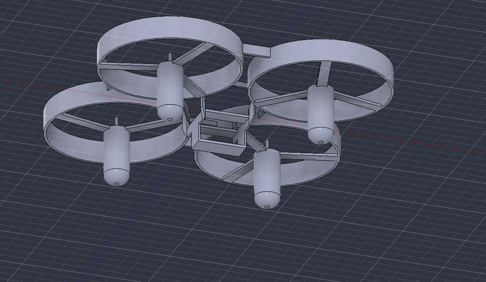
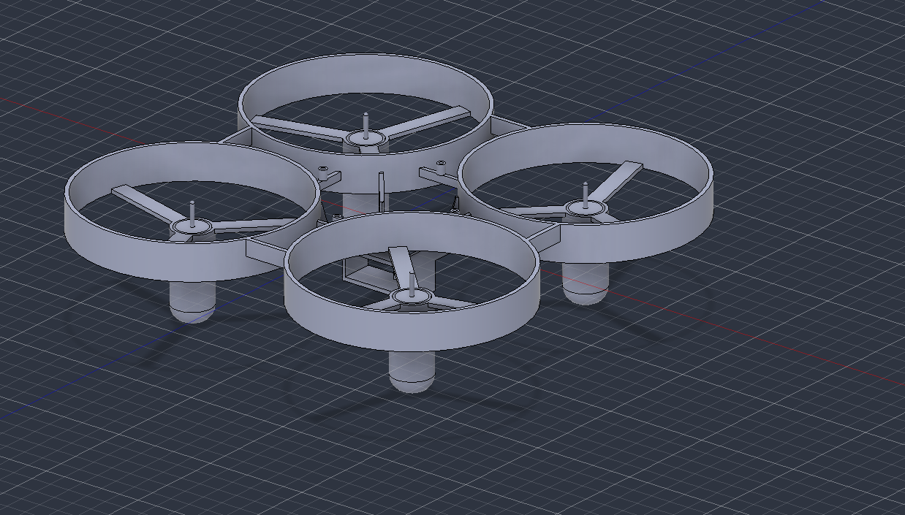
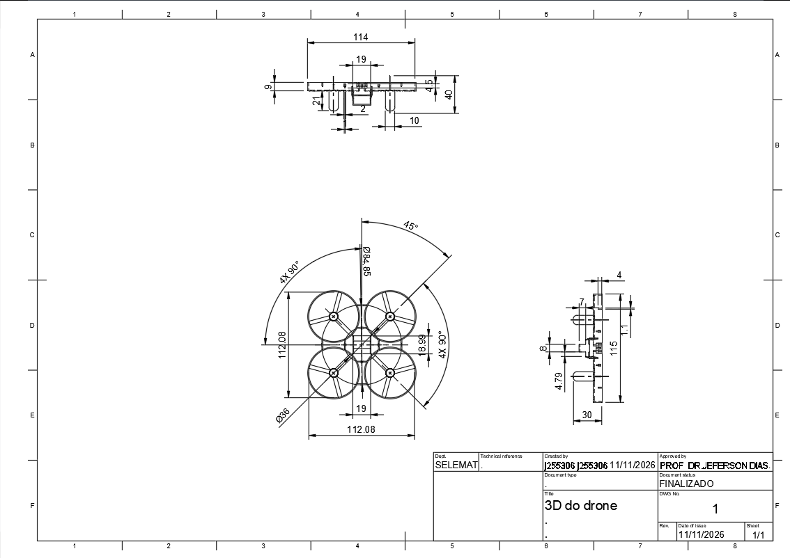
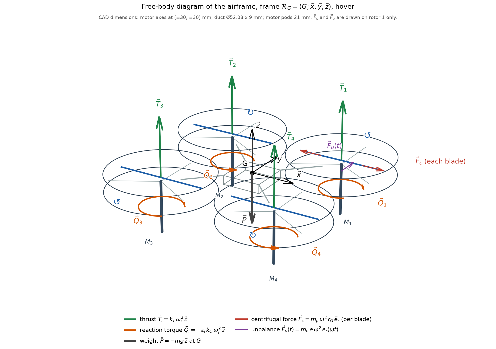
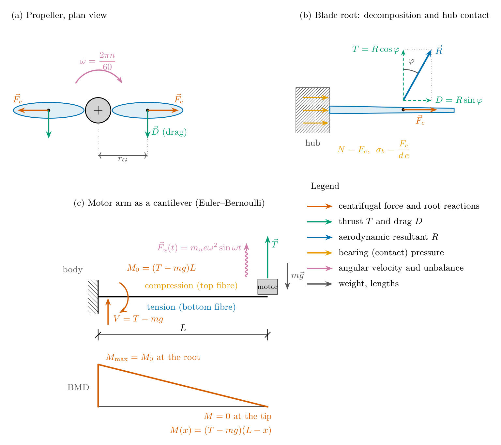
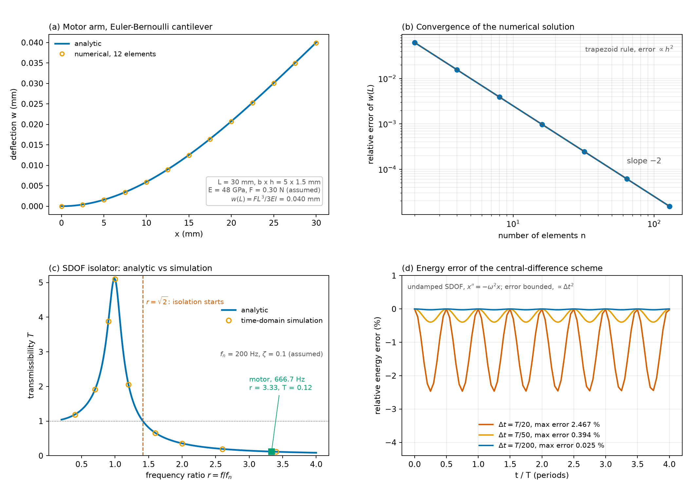
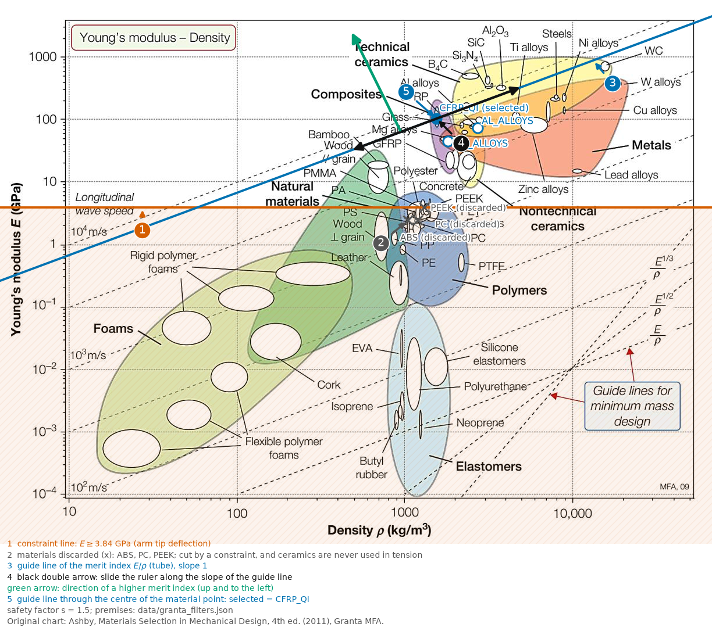
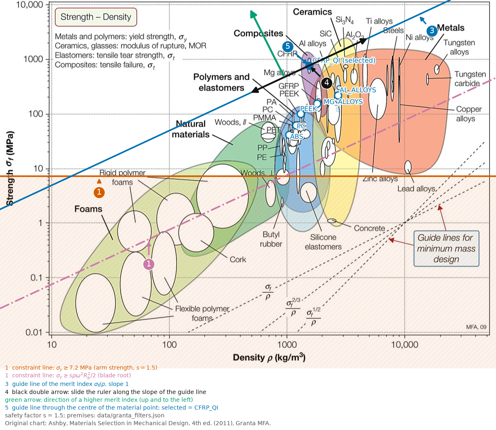
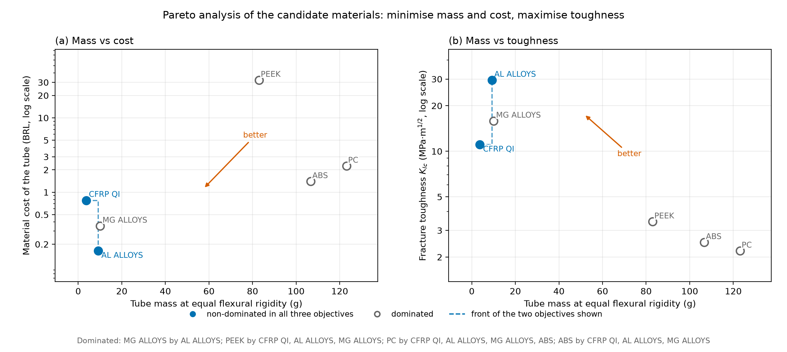
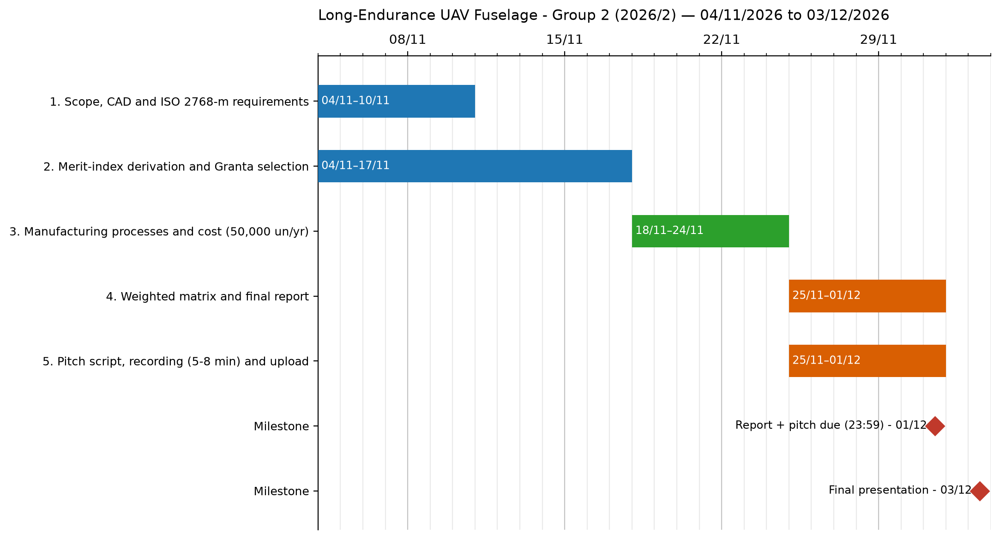

# Long-Endurance UAV Fuselage: Material Selection & Manufacturing Design

**UNICAMP (FCA, Limeira) - Course ER700/EU910 - Materials Selection for Engineering** | Prof. Dr. Jeferson Almeida Dias | Group 2, 2026/2 [14]

<div align="center">

[](https://github.com/LucasTramonte/long-endurance-uav-material-selection/actions/workflows/ci.yml)
[](LICENSE)
[](#quick-start)
[](pyproject.toml)
[](docs/english_report/technical_report_en.pdf)

**[Read the report (PDF)](docs/english_report/technical_report_en.pdf)** &nbsp;·&nbsp; [Merit indices](#section-2-mathematical-derivation-of-merit-indices) &nbsp;·&nbsp; [Decision matrix](#section-6-weighted-decision-matrix-and-final-recommendation) &nbsp;·&nbsp; [Project management](#project-management) &nbsp;·&nbsp; [Quick start](#quick-start)

</div>

> **Start here.** The [English report (PDF)](docs/english_report/technical_report_en.pdf) contains the whole study: requirements, merit-index derivations, Granta screening, environmental filters, manufacturing, decision matrix and project plan. It is generated from this README, which is also readable online below.

> **Data status.** Property values in [`data/materials_db.json`](data/materials_db.json) are *representative* typical values (Granta/MatWeb order of magnitude). They must be replaced with the team's actual Ansys Granta / MatWeb exports before submission (see [`docs/ansys_granta_notes.md`](docs/ansys_granta_notes.md)). All numbers in this report are generated by the code in `src/` from that file, so updating the data updates the results. Dimensions in Section 1.3 are read from the team's CAD drawing (Figure 2); mass, endurance and environment figures are **project assumptions**. Numbers in square brackets, e.g. [1], refer to the [References](#references).

## Contents

1. [Executive summary](#executive-summary)
2. [Technical report](#technical-report): [S1 Specs](#section-1-product-specifications-functional-requirements-geometry-and-mass-targets) | [S2 Merit indices](#section-2-mathematical-derivation-of-merit-indices) | [S3 Granta & Ashby](#section-3-ansys-granta-screening-and-ashby-mapping) | [S4 Environmental filters](#section-4-advanced-environmental-filtering) | [S5 Manufacturing](#section-5-manufacturing-process-engineering) | [S6 Decision](#section-6-weighted-decision-matrix-and-final-recommendation)
3. [Project management](#project-management)
4. [Open points vs. team draft](#open-points-to-resolve-with-the-team-draft)
5. [Repository structure & quick start](#repository-structure) | [Benchmark](#65-benchmark-against-a-published-case) | [References](#references)

---

## Executive Summary

**Context.** The product is a long-endurance **environmental-mapping quadcopter** in a compact **ducted (quad-duct) layout, about 112 x 112 x 40 mm** (CAD in [`cad/`](cad/README.md)). Its fuselage (central body carrying battery, flight controller and payload, four duct rings and motor mounts) must be as light as possible to maximise flight time, while remaining stiff enough to keep the payload gimbal stable, tough enough to survive hard landings, and durable under sun and humidity. Production volume is **50,000 units/year**; unspecified dimensions follow **ISO 2768-m** general tolerances [4]. The method follows Ashby [1] and the course lectures [13].

**Method.** The Ashby approach taught in the course: translate function/constraints/objective into merit indices, screen with hard limits (Ansys Granta), rank on Ashby charts, then resolve the remaining trade-offs - manufacturability and cost at volume - with a weighted decision matrix.

**Headline results** (representative data; regenerate with `python -m src.analysis.decision_matrix`):

| Finding | Result |
|---|---|
| Lightest tube at equal flexural rigidity (IM1 = E/rho) | **CFRP** (3.7 g vs 9.2 g for the aluminium-alloys record on the reference tube, -60 %) |
| Best cost-adjusted stiffness (IM3 = E/Cv) | **Aluminium alloys** (IM3 = 1.5); CFRP is ~4.7x worse (0.32) |
| Weighted decision matrix (default weights) | **1. CFRP (0.643)**, 2. aluminium alloys (0.629), 3. magnesium alloys (0.411); PEEK, PC and ABS are screened out (and would rank 4th to 6th anyway) |
| Sensitivity | the first two are a near-tie: aluminium alloys overtake CFRP once the mechanical weight falls below about 0.33 (cost-driven scenarios) |
| Motor vibration (40,000 RPM = 666.7 Hz) | Elastomeric dampers with f_n <= 182 Hz, zeta = 0.1 give transmissibility 0.1 [10] |

**Recommendation.** The matrix with the Granta data selects **quasi-isotropic CFRP** by a small margin (0.643 against 0.629 for the aluminium alloys at the default weights), because it is by far the lightest (-60 % tube mass) and its penalty is cost and manufacturability. The margin is smaller than the uncertainty of the data (Granta ranges, team scores), and aluminium wins whenever cost weighs more (Section 6.3): **CNC-machined aluminium alloy** (7075-T6 as the reference grade) is the lower-risk alternative at 50,000 units/year. CFRP needs an out-of-autoclave/press-cure process, because hand-laid autoclave curing is a labour and tooling bottleneck at this volume (Section 5.2).

---

# Technical Report

## Section 1: Product Specifications, Functional Requirements, Component Geometry and Mass Targets

### 1.1 Mission and product

| Parameter | Value | Source |
|---|---|---|
| Application | Environmental mapping (photogrammetry, multispectral, air quality) | Brief [14] |
| Configuration | Ducted quadcopter, 4 brushless motors up to 40,000 RPM | Brief / CAD |
| Production volume | 50,000 units/year | Brief [14] |
| General tolerances | ISO 2768-m | Brief [14], [4] |
| Target endurance | >= 45 min | *Assumption* |
| Take-off mass (MTOW) | 150 g | *Assumption* |
| Airframe (fuselage) mass target | <= 22 g (about 15 % of MTOW) | *Assumption* |
| Operating environment | -10 to +50 C, humidity up to 95 %, direct sunlight, light rain | *Assumption* |

### 1.2 Functional requirements

| ID | Requirement | Type |
|---|---|---|
| FR1 | Carry bending loads from motor thrust through the arms/spokes into the body without excessive deflection (payload pointing error) | Stiffness constraint |
| FR2 | Survive handling and hard landing without cracking | Toughness constraint (K_Ic > 2.0 MPa.m^0.5) |
| FR3 | 24 h water absorption < 0.2 % [6] (dimensional stability, electronics sealing) | Environmental |
| FR4 | UV resistance >= "Acceptable" for sun exposure | Environmental |
| FR5 | Attenuate 666.7 Hz motor vibration towards the IMU/camera | Dynamic |
| FR6 | Manufacturable at 50,000 units/year within ISO 2768-m | Process / cost |
| FR7 | Minimum mass | Objective |
| FR8 | Minimum cost | Objective |

### 1.3 Component geometry (from the team's CAD)

The model is a quad-duct airframe: four annular ducts with three-spoke motor mounts, a central body/battery cradle and four motor pods, at 4 x 90 deg. Key dimensions from drawing Y (all mm):

| Dimension | Value |
|---|---|
| Plan envelope | 112.08 x 112.08 |
| Front view (width x height) | 114 x 40 |
| Side view (length x height) | 115 x 30 |
| Motor/duct pitch circle | Ø84.85 |
| Central body | 19 x 18.99 |
| Motor pod length | 21 (Ø10) |

| Perspective Xa | Perspective Xb |
|:-:|:-:|
|  |  |
| **Figure 1a** - View from below | **Figure 1b** - View from above |



**Figure 2** - Technical drawing (first-angle projection layout, [3]) with dimensions; ISO 2768-m governs unspecified tolerances [4], [5]. Enlarged front/top/side views, the full dimension table, tolerance tables and the checklist of missing items are in [`cad/README.md`](cad/README.md).

**Mass budget.** The airframe target is <= 22 g (assumption). A thin-walled tube of the reference geometry (mean radius 18 mm, length 30 mm; Section 3.2) with the wall of an aluminium alloy (1.0 mm) weighs 9.2 g, so a metal airframe must use local thinning and pockets (Section 5.1); the CFRP equivalent (3.7 g) leaves much more margin.

**Currently used materials (brief requirement).** Compact ducted drones commonly use injection-moulded thermoplastics (ABS, PC, polyamide-glass fibre) for ducts and bodies, with CFRP plates or metal parts in premium models. *[Source needed: team to add manufacturer datasheets/teardowns - not verified here.]*

### 1.4 Mechanical actions on the airframe - formal model



**Figure 3** - Free-body diagram drawn on the drone (CAD dimensions): thrust $`\vec T_i`$ of each rotor, aerodynamic reaction torque $`\vec Q_i`$ on the airframe, weight $`\vec P`$ at the centre of mass $`G`$, blade centrifugal force $`\vec F_c`$ and rotating unbalance force $`\vec F_u`$.



**Figure 4** - Load paths on a blade, its hub and a motor arm: (a) centrifugal force and drag on the blades; (b) decomposition of the aerodynamic resultant and hub contact compression; (c) the arm as a cantilever with its bending-moment diagram (BMD). The governing equations are those of Sections 1.4.1 to 1.4.5.

The model uses the vector/torsor formalism of classical (French-school) mechanics [18], [19]: isolate a system, define a frame, write the action torsors, apply the fundamental principle of statics (PFS) or dynamics (PFD), then cut the beam to obtain the cohesion torsor (RDM). Torsors are written $`\{\mathcal T_{i\to j}\}_A=\{\vec R_{i\to j}\;;\;\vec M_{A,i\to j}\}`$, with resultant $`\vec R`$ and moment $`\vec M_A`$ at point $`A`$.

**Frame and notation.** $`\mathcal R_G=(G;\vec x,\vec y,\vec z)`$ with $`\vec z`$ upward; rotor $`i`$ ($`i=1\dots4`$) has its axis through $`M_i`$ with $`\overrightarrow{GM_i}=(x_i,y_i,0)`$, $`(x_i,y_i)=a(\pm1,\pm1)`$, $`a=30`$ mm (CAD pitch circle $`\varnothing 84.85`$ mm). Rotors 1, 2, 3, 4 sit at $`(+,+)`$, $`(-,+)`$, $`(-,-)`$, $`(+,-)`$; $`\varepsilon_i=+1`$ if rotor $`i`$ spins counter-clockwise seen from $`+\vec z`$, otherwise $`-1`$ ($`\varepsilon=(+1,-1,+1,-1)`$). System $`S`$: airframe plus motors; mass $`m`$; $`\vec P=-mg\,\vec z`$.

#### 1.4.1 Actions of the rotors on the airframe

```math
\vec T_i = k_T\,\omega_i^{2}\,\vec z,\qquad \vec Q_i=-\varepsilon_i\,k_Q\,\omega_i^{2}\,\vec z,\qquad k_T=C_T\,\rho_a\,\pi R^{4},\quad k_Q=C_Q\,\rho_a\,\pi R^{5}
```

($`\rho_a`$ air density, $`R`$ rotor radius, $`C_T`$, $`C_Q`$ thrust and torque coefficients [19]). The sign of $`\vec Q_i`$ is the reaction of the air on the airframe, opposite to the spin of the rotor.

#### 1.4.2 Equilibrium in hover (PFS)

The torsor of all external actions on $`S`$, reduced at $`G`$, is

```math
\{\mathcal T_{ext\to S}\}_G=\left\{\begin{aligned}\vec R&=\Big(\textstyle\sum_i T_i-mg\Big)\vec z\\[2pt]\vec M_G&=\textstyle\sum_i \overrightarrow{GM_i}\wedge T_i\vec z+\sum_i \vec Q_i\end{aligned}\right\}=\{\vec 0;\vec 0\}
```

With $`\overrightarrow{GM_i}\wedge T_i\vec z=(y_iT_i,\,-x_iT_i,\,0)`$, projection on $`\vec x,\vec y,\vec z`$ gives the four scalar conditions

```math
\sum_i T_i = mg,\qquad \sum_i y_iT_i=0,\qquad \sum_i x_iT_i=0,\qquad \sum_i \varepsilon_i\,\omega_i^{2}=0 .
```

By symmetry $`T_i=mg/4`$ and $`\omega_i=\sqrt{mg/(4k_T)}`$. For the assumed take-off mass $`m=150`$ g (Section 1.1), $`T_i=0.368`$ N per rotor. Small thrust differences $`\delta T_i`$ produce the control wrench (mixing) of the airframe:

```math
\begin{pmatrix}\delta F_z\\ \tau_x\\ \tau_y\\ \tau_z\end{pmatrix}=\begin{pmatrix}1&1&1&1\\ a&a&-a&-a\\ -a&a&a&-a\\ -c&c&-c&c\end{pmatrix}\begin{pmatrix}\delta T_1\\ \delta T_2\\ \delta T_3\\ \delta T_4\end{pmatrix},\qquad c=\frac{k_Q}{k_T}
```

#### 1.4.3 Blade centrifugal force and hub contact (PFD)

For a blade element of linear mass $`\mu(\rho)`$ at distance $`\rho`$ from the axis, the inertia force in the frame attached to the rotor is $`\mu\,\omega^{2}\rho\,d\rho`$ directed along $`\vec e_r`$. The traction in the blade at radius $`r`$ and the force at the root are

```math
N(r)=\omega^{2}\!\int_{r}^{R}\mu(\rho)\,\rho\,d\rho,\qquad F_c=N(0)=m_p\,\omega^{2}\,r_G
```

with $`m_p`$ the blade mass and $`r_G`$ the distance of its centre of mass to the axis. At $`n=40\,000`$ rpm: $`\omega=2\pi n/60=4189`$ rad/s and $`f=n/60=666.7`$ Hz. With the *assumed* values $`m_p=0.2`$ g, $`r_G=12`$ mm: $`F_c=42`$ N, about $`2\times10^{4}`$ times the blade weight. The root is reacted by a bearing (contact) pressure on the hub, averaged as $`\sigma_b=F_c/(d\,e)`$ (pin diameter $`d`$, bearing length $`e`$).

The aerodynamic force on the blade decomposes into thrust and drag: $`\vec R_{aero}=\vec T+\vec D`$, $`T=R\cos\varphi`$, $`D=R\sin\varphi`$, and the rotor torque is $`Q\simeq D\,r_G`$ per blade.

*Centrifugal stress of the blade.* For a uniform blade of density $`\rho`$ and length $`R_b`$ the root tension is $`\sigma_c=N(0)/A=\rho\,\omega^{2}R_b^{2}/2`$, the same model as $`F_c=m_p\omega^{2}r_G`$ with $`r_G=R_b/2`$. With the *assumed* $`R_b=2r_G=24`$ mm at 40 000 rpm, $`\sigma_c`$ is 7.8 MPa (CFRP), 13.8 MPa (aluminium alloys) and 9.1 MPa (magnesium alloys), at the centre of the Granta density ranges. With $`s=1.5`$ this uses only 2 %, 19 % and 13 % of the lowest yield strength of each range, so static centrifugal tension does not decide the material; fatigue (Section 5.4) does. The requirement $`\sigma_y\ge s\,\rho\,\omega^{2}R_b^{2}/2`$ is a line of slope 1 on the $`\sigma`$-$`\rho`$ chart (Section 3.3). Because the centrifugal load is tensile, ceramics are not used for the blades.

#### 1.4.4 Motor arm as a cantilever (RDM)

The arm is modelled as an Euler-Bernoulli beam of length $`L`$, rectangular section $`b\times h`$, area $`S=bh`$, $`I_{Gy}=bh^{3}/12`$, built in at the body (point $`A`$, $`x=0`$) and loaded at the motor (point $`M`$, $`x=L`$) by $`\vec F=(T-m_mg)\,\vec z`$ ($`m_m`$: motor mass). Hypotheses: Hookean linear elasticity, small displacements, plane sections remain plane, own weight neglected.

*Reaction torsor of the body on the arm* (PFS on the arm):

```math
\{\mathcal T_{0\to1}\}_A=\{\vec R_A=-\vec F\;;\;\vec M_A=-\overrightarrow{AM}\wedge\vec F\},\qquad \vec M_A=(T-m_mg)\,L\,\vec y
```

*Cohesion torsor* at abscissa $`x`$, action of the downstream part ($`x'>x`$) on the upstream part, at the section centroid $`G_x`$:

```math
\{\mathcal T_{coh}\}_{G_x}=\left\{\begin{aligned}\vec R_{coh}&=N\vec x+T_y\vec y+T_z\vec z\\ \vec M_{coh}&=M_t\vec x+M_{fy}\vec y+M_{fz}\vec z\end{aligned}\right\}\quad\Rightarrow\quad N=0,\;\;T_z=T-m_mg,\;\;M_{fy}(x)=-(T-m_mg)(L-x)
```

*Normal stress* (Navier) and its maximum, at the root:

```math
\sigma_{xx}(x,z)=\frac{N}{S}+\frac{M_{fy}(x)}{I_{Gy}}\,z\qquad\Rightarrow\qquad |\sigma_{xx}|_{max}=\frac{6\,(T-m_mg)\,L}{b\,h^{2}}
```

(upper fibre $`z>0`$ in compression, lower fibre in tension, as in Figure 4c). *Deflection* (small displacements):

```math
E\,I_{Gy}\,w''(x)=-M_{fy}(x)\quad\Rightarrow\quad w(L)=\frac{(T-m_mg)\,L^{3}}{3\,E\,I_{Gy}}
```

The stiffness requirement (maximum allowable $`w(L)`$, payload pointing error) and the strength requirement ($`|\sigma|_{max}\le\sigma_y/s`$, safety factor $`s`$) lead to the merit indices $`E/\rho`$ and $`\sigma_y/\rho`$ of Section 2.

#### 1.4.5 Vibration excitation

An unbalance $`m_u`$ at eccentricity $`e`$ creates a rotating force in the rotor plane, transmitted to the arm through the mount:

```math
\vec F_u(t)=m_u\,e\,\omega^{2}\,\vec e_r(\omega t)=m_u\,e\,\omega^{2}\,(\cos\omega t\;\vec x+\sin\omega t\;\vec y)
```

Its frequency is $`f=\omega/2\pi=666.7`$ Hz. The elastomeric mount, modelled as a Kelvin-Voigt single-degree-of-freedom isolator, attenuates it when $`r=f/f_n>\sqrt2`$ (Section 5.3, [10]).

**Scope of the aerodynamic loads.** The model includes the *rotor* aerodynamics in hover: the thrust $`T_i`$ and reaction torque $`Q_i`$ of each rotor (Section 1.4.1), the split of the blade force into thrust and drag (Section 1.4.3), and the thrust as the load that bends the arm (Section 1.4.4). The thrust is fixed by the equilibrium $`T_i=mg/4`$, not computed from the blade aerodynamics ($`C_T`$, $`C_Q`$ are not evaluated). It does **not** include: aerodynamic force on the duct and fuselage (drag, duct lift), forward flight and gusts, thrust transients during manoeuvres (a load factor $`n>1`$ on $`mg`$), ground effect and aerodynamic damping. These would raise the design load above the hover value; until they are modelled the safety factor of Section 3.3 has to cover them.

### 1.5 Verification of the physics models

A force diagram shows *what* acts on the airframe; it does not show that the equations are solved correctly. Following the practice of the course's numerical-physics notes (schematic, then equations, then a numerical scheme checked against known results and against its own time step), the two models that carry the results of Section 1.4 are verified numerically in Figure 5. The torsors, the mixing matrix, the cohesion torsor, Navier's stress and the deflection of Section 1.4 are also recomputed symbolically with SymPy [22] and checked against the formulas printed here.



**Figure 5** - Verification (a) Motor arm as a cantilever: analytic $`w(x)=Fx^{2}(3L-x)/6EI`$ against a numerical double integration of $`EI\,w''=M(x)`$. (b) The tip error falls with slope $`-2`$ in the number of elements $`n`$, the expected second-order behaviour of the trapezoid rule. (c) Isolator of Section 1.4.5: the analytic transmissibility $`T(r)`$ against the steady-state amplitude of a time-domain simulation (markers), with the motor excitation at 666.7 Hz marked. (d) Relative energy error of the central-difference scheme for three time steps: it stays bounded and scales as $`\Delta t^{2}`$ (2.47 %, 0.39 %, 0.025 % for $`T/20`$, $`T/50`$, $`T/200`$). Arm dimensions, load, $`f_n`$ and $`\zeta`$ are *assumptions* written in the plots; the figure checks the models, not the design.

---

## Section 2: Mathematical Derivation of Merit Indices

**Design translation (Lecture 4 [13], Ashby [1] ch. 5):** *Function* - thin-walled tube (fuselage and duct shell) carrying bending load / tie carrying tension. *Constraints* - fixed length $`L`$ and mean radius $`R`$; prescribed stiffness $`S^\star`$ (or strength $`F`$). *Objectives* - minimise mass $`m`$; minimise cost $`C`$. *Free variable* - wall thickness $`t`$ (and hence area).

### Assumptions

1. **Hookean elastic regime**: stress is proportional to strain; no yielding at service load.
2. **Small-deflection (Euler-Bernoulli / Kirchhoff) theory**: deflection << thickness scale of the span, plane sections remain plane.
3. Isotropic, homogeneous material (composites enter via their quasi-isotropic effective $`E`$ - Section 2.5).
4. Fixed $`L`$ and mean radius $`R`$; the wall thickness is the only free geometric variable; constant thin-walled section.

### 2.0 General formulation (mathematical programming)

Every index below is the answer to a constrained minimisation problem. With $`\mathbf x`$ the free design variables (here the thickness or the area) and $`\mathbf p`$ the material properties:

```math
\begin{aligned}
\min_{\mathbf x\in\mathcal X}\quad & f(\mathbf x;\mathbf p) && \text{objective (mass } m \text{ or cost } C)\\
\text{s.t.}\quad & g_j(\mathbf x;\mathbf p)\le 0,\quad j=1,\dots,n && \text{constraints (stiffness, strength)}
\end{aligned}
```

Eliminating $`\mathbf x`$ with the active constraint gives the *performance equation* $`f^\star=\underbrace{\Phi}_{\text{requirement}}\cdot\underbrace{\Gamma}_{\text{geometry}}\cdot P(\mathbf p)`$. The material group $`P`$ is the **performance index to minimise**; the classical merit index is its reciprocal, $`IM=1/P`$, so *minimising $`P`$ and maximising $`IM`$ select the same material*. The derivations of 2.1-2.3 are generated and checked symbolically with SymPy [22].

### 2.1 IM1 - light, stiff thin-walled tube in bending

The fuselage and duct shells are thin-walled tubes whose mean radius $`R`$ is fixed by the packaging (the rotor and the battery fix it), so the wall thickness $`t`$ is the free variable. With a fixed radius and a free thickness the index is $`E/\rho`$, the formulation confirmed by the course monitor's review of the team's derivation. For a tube of length $`L`$ with $`I\simeq\pi R^{3}t`$ and a flexural stiffness $`S=48EI/L^{3}`$ (simply supported, central load) that must reach $`S^\star`$:

```math
\begin{aligned}
\min_{t>0}\quad & m(t)=2\pi R\,t\,L\,\rho\\
\text{s.t.}\quad & S(t)=\frac{48\,E\,\pi R^{3}\,t}{L^{3}}\;\ge\;S^\star
\end{aligned}
```

$`m`$ increases with $`t`$ and $`S`$ increases with $`t`$, so the constraint is active at the optimum, $`S(t^\star)=S^\star`$:

```math
t^\star=\frac{S^\star L^{3}}{48\pi\,E\,R^{3}}\quad\Longrightarrow\quad m^\star=\underbrace{\frac{S^\star L^{4}}{24\,R^{2}}}_{\text{fixed by the design}}\;\cdot\;\underbrace{\frac{\rho}{E}}_{P_1}
```

The best material solves the outer problem $`\min_{k}\,P_{1,k}`$, that is

```math
\boxed{\;P_1=\min_k\frac{\rho_k}{E_k}\quad\Longleftrightarrow\quad IM_1=\max_k\frac{E_k}{\rho_k}\;}
```

Ashby chart guideline: slope 1 on $`\log E`$ vs $`\log\rho`$. The thickness enters $`I`$ linearly when the radius is fixed, which is why the exponent is 1; for a flat panel of fixed width and free thickness ($`I\propto t^{3}`$) it would be $`E^{1/3}/\rho`$, the plate index of the benchmark thesis (Section 6.5). An earlier version of the team's draft used that exponent for the tube, and the review corrected it. The derivation is generated and checked symbolically (SymPy [22]).

### 2.2 IM2 - tensile strength per unit mass

A skin/tie loaded by a tensile force $`F`$ with free cross-section $`A`$:

```math
\begin{aligned}
\min_{A>0}\quad & m(A)=\rho\,A\,L\\
\text{s.t.}\quad & \frac{F}{A}\le\sigma_y\;\Longleftrightarrow\;A\ge\frac{F}{\sigma_y}
\end{aligned}
\qquad\Longrightarrow\qquad A^\star=\frac{F}{\sigma_y},\quad m^\star=F\,L\cdot\underbrace{\frac{\rho}{\sigma_y}}_{P_2}
```

```math
\boxed{\;P_2=\min_k\frac{\rho_k}{\sigma_{y,k}}\quad\Longleftrightarrow\quad IM_2=\max_k\frac{\sigma_{y,k}}{\rho_k}\;}
```

Chart guideline: slope 1 on $`\log\sigma_y`$ vs $`\log\rho`$.

### 2.3 IM3 - volumetric cost for the stiffness-limited tube

With $`C_m`$ the material price per kg and $`C_{v,R}=C_m\,\rho`$ the volumetric cost (BRL/m^3 in the Granta data), the objective becomes the cost $`C=C_m\,m`$ under the same stiffness constraint as 2.1:

```math
\begin{aligned}
\min_{t>0}\quad & C(t)=C_m\,2\pi R\,t\,L\,\rho=C_{v,R}\,2\pi R\,t\,L\\
\text{s.t.}\quad & \frac{48\,E\,\pi R^{3}\,t}{L^{3}}\ge S^\star
\end{aligned}
\qquad\Longrightarrow\qquad C^\star=\frac{S^\star L^{4}}{24\,R^{2}}\cdot\underbrace{\frac{C_{v,R}}{E}}_{P_3}
```

```math
\boxed{\;P_3=\min_k\frac{C_{v,R,k}}{E_k}\quad\Longleftrightarrow\quad IM_3=\max_k\frac{E_k}{C_{v,R,k}}\;}
```

### 2.4 Units and implementation

Implementation units: $`E`$ in GPa, $`\sigma_y`$ in MPa, $`\rho`$ in kg/m^3 (converted to Mg/m^3), $`C_{v}`$ in BRL/m^3 (IM3 reported per kBRL/m^3). The code also returns the minimisation form $`P_k=1/IM_k`$. As a cross-check, the tube mass ratio of two materials at equal flexural rigidity $`EI`$ equals the inverse ratio of IM1.

**Cost and currency.** A price list changes with the country's currency and with inflation, so absolute price values age quickly. The mass cost is $`C_m`$ (currency/kg), the volumetric cost $`C_{v}=C_m\rho`$ (currency/m^3) and the cost of a part $`C=C_m\,m`$. To compare across currencies and dates the charts use the *relative* volumetric cost $`C_{v,R}=C_m\rho/(C_{m}\rho)_{ref}`$ (`relative_volumetric_cost`); the course notes use steel as the reference: the Granta *Low carbon steel* record (price 6.31-9.2 BRL/kg, density 7800-7820 kg/m^3) gives $`C_{v,steel}\approx59\,500`$ BRL/m^3. The ranking uses the absolute $`C_v`$ in BRL/m^3 (the ratios, and the slope of the guide lines, do not depend on the reference); the relative cost is reported next to it (Section 3.1).

### 2.5 Composites and model limitations

- **Anisotropy**: IM1 uses a scalar $`E`$. For laminates use the effective in-plane modulus from classical laminate theory [9] (`composite_anisotropy.py`): for 55 % fibre volume fraction, $`[0]_8`$ gives $`E_x`$ = 128 GPa but $`E_y`$ = 7.6 GPa; $`[0/{+45}/{-45}/90]_s`$ gives a uniform **47 GPa** (database value for CFRP-QI: 48 GPa).
- IM1 holds for a thin wall ($`t\ll R`$), a fixed radius and a free thickness; with a minimum-gauge limit (e.g. 0.5 mm for handling) $`t\ge t_{min}`$ is an extra constraint and lighter materials cannot use their full advantage. The thin-wall assumption holds for CFRP, aluminium and magnesium at equal rigidity (walls of 0.7 to 1.6 mm against an 18 mm radius); PEEK, PC and ABS would need walls of 18.7, 30.2 and 30.1 mm, larger than the radius, so they cannot reach that rigidity as a thin tube (Section 3.2).
- Small-deflection theory underestimates deflection for thin shells with large displacements; local buckling, ovalisation, dents and joint design are not captured.
- Single-objective indices ignore interaction effects: use the multi-objective/Pareto treatment and the decision matrix (Section 2.6 and Section 6).
- Material data are typical values; scatter (composites +-10-15 %) is not propagated.
- IM2 with $`\sigma_y`$ for composites uses the quasi-isotropic tensile strength; fatigue and notch sensitivity are not included in the index (Section 5.4).

### 2.6 Material selection as an optimisation problem

**Screening (hard constraints).** The candidate set is the feasible set of the hard constraints $`h_i`$ (UV resistance, 24 h water absorption, $`K_{Ic}`$, maximum temperature, density):

```math
\mathcal K=\left\{k\;:\;h_i(\mathbf p_k)\le 0,\ i=1,\dots,5\right\}
```

**Single-objective selection** with one index, for example minimum mass: $`k^\star=\arg\min_{k\in\mathcal K}P_{1,k}`$.

**Weighted decision matrix (Section 6).** With criterion scores $`s_{kj}\in[0,1]`$ normalised by the best candidate ($`s_{kj}=1`$ is best) and weights $`w_j\ge 0`$, $`\sum_j w_j=1`$, maximising the weighted score is the same as minimising the weighted *shortfall*:

```math
k^\star=\arg\min_{k\in\mathcal K}\;\sum_{j=1}^{4} w_j\,\bigl(1-s_{kj}\bigr)\;=\;\arg\max_{k\in\mathcal K}\;\sum_{j=1}^{4} w_j\,s_{kj}
```

with $`s_{k,\mathrm{mech}}=\tfrac12\big(\tfrac{IM_{1,k}}{\max IM_1}+\tfrac{IM_{2,k}}{\max IM_2}\big)`$ and $`s_{k,\mathrm{cost}}=\tfrac{IM_{3,k}}{\max IM_3}`$.

**Multi-objective (Pareto) view.** Without fixing weights, the non-dominated candidates solve the vector problem (all objectives minimised; $`K_{Ic}`$ is maximised, hence the sign):

```math
\min_{k\in\mathcal K}\;\bigl(m_k,\;C_k,\;-K_{Ic,k}\bigr),\qquad
\mathcal P=\bigl\{k\in\mathcal K:\ \nexists\, l\in\mathcal K\ \text{with}\ \mathbf f_l\le\mathbf f_k\ \text{and}\ \mathbf f_l\ne\mathbf f_k\bigr\}
```


---

## Section 3: Ansys Granta Screening and Ashby Mapping

**Source of the data.** Every material property in this report comes from Ansys Granta EduPack 2024 R1 (version 24.1.1), the only data source of the repository. Granta gives each property as a *range* (the extent of its bubble on an Ashby chart). The records read so far are **CFRP, epoxy matrix (isotropic)** (epoxy with continuous carbon fibre, quasi-isotropic layup), **Aluminum alloys**, **Magnesium alloys**, **Polyetheretherketone (PEEK)**, **Polycarbonate (PC)** and **Acrylonitrile butadiene styrene (ABS)**; the **Low carbon steel** record was read as the reference of the relative cost, not as a candidate; the GFRP record was read only for density and price, so it is not ranked. The alloy records are family-level (all aluminium or magnesium alloys); 7075-T6 stays the reference grade for the process discussion. The PEEK record is the *unfilled* polymer: the course candidate, PEEK with 30 % carbon fibre, was not found in the tree. UV resistance and 24 h water absorption are not among the attributes of this Granta installation (checked in the axis and limit lists). Prices are in BRL/kg, as shown by this Granta installation, and Granta marks some values as estimated (for example the CFRP price and toughness, the PEEK modulus and price, the fatigue strengths).

*Reading the ranges.* The representative value is the **centre of the bubble** (geometric mean of the range); it is used for the indices and for the ranking. A constraint that **cuts the bubble** discards the material, so the screening uses the lowest value of each range for a minimum requirement and the highest for a maximum.

### 3.1 Granta properties and indices (shortlist)

| Material | rho (kg/m3) | E (GPa) | sigma_y (MPa) | K_Ic (MPa.m^0.5) | Price (BRL/kg) | Cv (BRL/m3) | IM1 | IM2 | IM3 |
|---|---|---|---|---|---|---|---|---|---|
| CFRP, epoxy matrix (isotropic) | 1500-1600 | 69-150 | 550-1050 | 6.12-20 | 197-219 | 321,781 | **65.7** | **490.5** | 0.32 |
| Aluminum alloys | 2640-2810 | 69-75 | 109-439 | 23-38 | 14.8-21 | 48,017 | 26.4 | 80.3 | **1.50** |
| Magnesium alloys | 1780-1840 | 42-46 | 109-216 | 14-18 | 31.7-38.8 | 63,469 | 24.3 | 84.8 | 0.69 |
| PEEK (unfilled) | 1300-1320 | 3.76-3.95 | 90-110 | 2.73-4.3 | 368-410 | 508,832 | 2.9 | 76.0 | 0.008 |
| Polycarbonate | 1190-1210 | 2.32-2.44 | 59.1-65.2 | 2.1-2.3 | 17.6-19.1 | 22,001 | 2.0 | 51.7 | 0.11 |
| ABS | 1030-1060 | 2.07-2.76 | 34.5-49.6 | 1.46-4.29 | 11.7-14.7 | 13,703 | 2.3 | 39.6 | 0.17 |

Ranges as read in Granta; $`C_v`$ and the indices use the centre of each range. Relative to the steel record ($`C_{v,steel}`$ = 59,506 BRL/m^3) the volumetric cost is 5.4 (CFRP), 0.81 (aluminium), 1.07 (magnesium), 8.6 (PEEK), 0.37 (PC) and 0.23 (ABS). Units: IM1 in GPa/(Mg/m^3); IM2 in MPa/(Mg/m^3); IM3 in GPa/(kBRL/m^3). Regenerate: `python -m src.analysis.export_tables --shortlist`.

### 3.2 Tube mass at equal flexural rigidity

Reference: flexural rigidity $`EI`$ of a **thin-walled tube with a 1.0 mm wall of the aluminium-alloys record, mean radius 18 mm and length 30 mm** (assumed duct-like shell read from the Ø36 duct feature and the 30 mm side height of the CAD drawing, which the CAD README flags as ambiguous; `reference_tube` in `data/granta_filters.json`). Mass ratios are size-independent; absolute values scale with $`R^{-2}L^{4}`$.

| Material | Wall thickness (mm) | Tube mass (g) | Material cost (BRL) |
|---|---|---|---|
| CFRP, epoxy matrix (isotropic) | 0.71 | **3.7** | 0.77 |
| Aluminum alloys | 1.00 | 9.2 | **0.16** |
| Magnesium alloys | 1.64 | 10.0 | 0.35 |
| PEEK (unfilled) | 18.7 (exceeds the 18 mm radius: formal value) | 83.0 | 32.2 |
| Polycarbonate | 30.2 (exceeds the radius: formal value) | 123.1 | 2.26 |
| ABS | 30.1 (exceeds the radius: formal value) | 106.7 | 1.40 |

### 3.3 Reading the Ashby charts: constraint line and guide line

The selection is made on the charts with five explicit steps. They are also written as a repository skill (`.claude/skills/ashby-chart-selection`) so that every future edit follows them.

1. **Mark the constraint.** The requirement is drawn as a straight line on the chart: a horizontal line for a minimum $`E`$ or $`\sigma`$. Here it comes from the arm model of Section 1.4.4: $`E\ge 4FL^{3}/(b\,h^{3}\,w_{max})`$ for the tip deflection and $`\sigma_y\ge s\,\sigma_{max}=s\,6FL/(b\,h^{2})`$ for strength. The blade root adds a second strength constraint, $`\sigma_y\ge s\rho\omega^{2}R_b^{2}/2`$, which is a *sloped* line of slope 1 on the $`\sigma`$-$`\rho`$ chart (Section 1.4.3).
2. **Discard the materials the constraint cuts.** If the line crosses a material bubble, part of that material cannot meet the requirement, so the material is discarded.
3. **Select the guide line of the merit index.** $`E/\rho`$ has slope 1 on the $`E`$-$`\rho`$ chart, $`\sigma_y/\rho`$ has slope 1 on the $`\sigma`$-$`\rho`$ chart and $`E/C_{v,R}`$ has slope 1 on the $`E`$-$`C_{v,R}`$ chart (Section 2).
4. **Slide the ruler along the slope** of the guide line across the chart, keeping the slope fixed.
5. **Keep a material only where the guide line passes through the centre of its bubble.** Materials above or to the left of the line have a higher index; the ones far from it are ranked, not selected.

**Premises (nothing is measured).** The loads come from `data/granta_filters.json`, block `load_cases`, and are assumptions of the team: arm $`F=0.30`$ N, $`L=30`$ mm, $`b\times h=5\times1.5`$ mm, allowable tip deflection 0.5 mm; rotor 40 000 rpm and blade length $`R_b=24`$ mm; safety factor $`s=1.5`$. The material properties are Granta ranges, not premises.

**Two rules that are always applied.** (i) *Ceramics are not used in tension*: their tensile strength is low and scattered, and the strength printed for ceramics on the chart is the modulus of rupture, not a tensile strength; they are removed from every tension-loaded selection. (ii) *The strength constraint includes a safety factor $`s`$ taken from the literature*, not chosen by the team: the default is $`s=1.5`$, the factor between limit and ultimate load in 14 CFR 25.303 [27]. That rule is written for transport aircraft, not for a 150 g UAV, and it was read through secondary copies; handbook values of 2.5 to 4 for uncertain dynamic loads exist (course slides and a trade article, not the textbook table). The factor is therefore an *assumption to be confirmed* against Shigley or the standard the course adopts; the charts can be redrawn for any $`s`$.



**Figure 6** - $`E`$-$`\rho`$ chart. Original chart: Ashby, *Materials Selection in Mechanical Design*, 4th ed., 2011 (Granta MFA) [1], annotated by the team. Arrow 1: the constraint $`E\ge 3.84`$ GPa (shaded: discarded region). Arrow 2: it cuts the boxes of PEEK ($`E`$ from 3.76 GPa), PC (2.32-2.44 GPa) and ABS (2.07-2.76 GPa), which are discarded. Arrow 3: the guide line of $`E/\rho`$ (slope 1). Arrow 4: the ruler slides along the slope. Arrow 5: the line passes through the centre of the CFRP box, the selected material; the aluminium and magnesium boxes lie below it. The green arrow points to the higher index. The shaded boxes are the Granta ranges of `data/materials_db.json` (the extent of each bubble), with a dot at the centre.



**Figure 7** - $`\sigma`$-$`\rho`$ chart (same source). The horizontal constraint $`\sigma_y\ge 7.2`$ MPa (arm, $`s=1.5`$) and the sloped blade-root line (pink, $`\sigma_y\ge s\rho\omega^{2}R_b^{2}/2`$) cut none of the Granta ranges: the lowest yield strength of the six records (34.5 MPa, ABS) is above both. Strength therefore does not decide the choice; the guide line of slope 1 ranks the materials, with CFRP first. The binding limits are elsewhere (stiffness and fatigue, Section 5.4).

**Cost charts.** The cost step is made in Granta with the price times the density (BRL/m^3) on the axis, since the attribute list of this installation has no relative cost; the slope-1 guide line of $`E/C_v`$ is the same in any unit of volumetric cost. The Granta prints go to `docs/figures/granta_*.png` (body: the three selection charts; appendix: every step). Chart stages and Granta notes: [`docs/ansys_granta_notes.md`](docs/ansys_granta_notes.md).

### 3.4 Pareto view: mass vs cost vs toughness

`python -m src.math_modeling.pareto_optimization --all --plot docs/figures/pareto.png`



Pareto-optimal among the shortlisted materials: **CFRP** (lightest) and **aluminium alloys** (cheapest and toughest). The magnesium alloys are dominated by the aluminium alloys (lighter, cheaper and tougher); PEEK, PC and ABS are dominated by the three materials that pass the screen (their masses are formal values, because the wall would exceed the radius). Mass is that of the reference tube of Section 3.2, cost is in BRL.

---

## Section 4: Advanced Environmental Filtering

Hard constraints (`data/granta_filters.json`), applied as Granta *limit stages* and in `decision_matrix.screen()`. A constraint that cuts the Granta range of a material discards it (the lowest value is tested for a minimum, the highest for a maximum):

| Constraint | Limit | CFRP | Aluminum alloys | Magnesium alloys | PEEK | PC | ABS |
|---|---|---|---|---|---|---|---|
| UV resistance | >= Acceptable | not available | not available | not available | not available | not available | not available |
| Water absorption, 24 h [6] | < 0.2 % | not available | not available | not available | not available | not available | not available |
| Fracture toughness K_Ic | > 2.0 MPa.m^0.5 | 6.12-20 (pass) | 23-38 (pass) | 14-18 (pass) | 2.73-4.3 (pass) | 2.1-2.3 (pass, marginal) | 1.46-4.29 (**cut**) |
| Max service temperature | > 80 C | 140-220 (pass) | 99.9-170 (pass) | 150-234 (pass) | 239-260 (pass) | 101-116 (pass) | 62.9-76.9 (**fail**) |
| Density | < 3000 kg/m^3 | 1500-1600 (pass) | 2640-2810 (pass) | 1780-1840 (pass) | 1300-1320 (pass) | 1190-1210 (pass) | 1030-1060 (pass) |

*Outcome*: CFRP, aluminium, magnesium, PEEK and PC pass the filters that could be evaluated (PC only marginally on toughness, 2.1 against a limit of 2.0). **ABS is eliminated**: the lower end of its toughness range (1.46) is below 2.0 and its maximum service temperature (up to 76.9 C) is below 80 C. UV resistance and 24 h water absorption are not available in this Granta installation, so those two filters are **not evaluated** (the dataset holds null and the code reports them). Practical notes:

- **UV**: epoxy matrices degrade under UV - CFRP needs a UV-stable clearcoat or paint (adds mass ~ 10-15 g/m^2 and a process step).
- **Moisture**: 0.2 % applies to the 24 h test (ASTM D570). Equilibrium moisture uptake of epoxy composites (typically ~0.5-1.5 %, see [9]) is higher and reduces matrix-dominated properties and hot/wet T_g - verify with the saturation value if the course requires it.
- **Toughness**: the CFRP record starts at 6.12 MPa.m^0.5 (an estimated value in Granta), far below the metals, and PC passes only marginally (2.1 MPa.m^0.5) in this fracture-mechanics measure although it is ductile in practice; wrought aluminium alloys such as 7075-T6 are susceptible to stress-corrosion cracking in the short-transverse direction - anodise and avoid sustained tension across the grain.
- Galvanic: CFRP in contact with aluminium fasteners corrodes the aluminium - insulate with glass ply or sealant.

---

## Section 5: Manufacturing Process Engineering

Production at 50,000 units/year (about 250 units/working day) drives the process choice more than raw material properties [7], [8].

**Process tree.** Processes are read as a tree. *Primary* processes give the general shape: casting (metals), extrusion, injection moulding, and powder-forming methods such as pressing (ceramics). *Secondary* processes adjust the shape or change the properties: heat treatment, drilling, cutting and machining. *Finishing* adds joining (fasteners) and surface engineering (paint, coatings). The material must be compatible with the whole chain, so the process is chosen with the material, not after it.

### 5.1 Multi-axis high-speed CNC machining (Al 7075-T6; DJI-style unibody approach)

Consumer-drone airframes are commonly produced as machined or die-cast unibody shells; this section applies a similar philosophy (not a description of any specific company's process).

| Parameter | Value / strategy |
|---|---|
| Machine | 5-axis (or 3+2) vertical machining centre, HSK-A63 spindle, through-spindle coolant |
| Spindle speed | **20,000 RPM** (Al 7075: carbide 3-flute, v_c ~ 600-1,000 m/min for D = 10-16 mm, h-speed trochoidal roughing) |
| Wall thickness | Roughed to 2.0 mm, finished to 1.5 mm; pockets/ribs to meet <= 200 g shell |
| Fixturing | Vacuum or dedicated soft jaws; 2 setups (outer + bay) |
| Tolerance | ISO 2768-m general; critical pads 0.05 mm flatness |
| Cycle time (assumed, ~114 mm part) | ~ 6 min/part -> 50,000 parts = 5,000 spindle-hours/year -> **2 machining cells** (one needed at ~6,000 h/year utilisation; second for redundancy) |
| Surface | Chemical film (Alodine) or anodise type II; paint optional |

*CFRP machining (trimming/drilling)*: diamond-coated or PCD tools, low feed with high RPM (15,000-20,000 RPM), full dust extraction (carbon dust is conductive and an inhalation hazard), backing support to avoid delamination.

### 5.2 CFRP curing

Autoclave prepreg cycle (typical 120 C-cure epoxy; follow the supplier datasheet):

| Stage | Setting |
|---|---|
| Layup / debulk | Hand or automated, [0/+45/-45/90]_s, debulk every 4 plies, vacuum >= 0.95 bar |
| Ramp 1 | 1-3 C/min to 80-90 C, hold 30 min (resin flow, volatile removal) |
| Pressurise | Apply 0.6 MPa (6 bar), keep vacuum |
| Ramp 2 | 2 C/min to **120 C**, cure hold 60-90 min |
| Cool | <= 3 C/min below 60 C under pressure |
| Post-cure (optional) | 140-180 C, 2 h free-standing for higher T_g |

**Volume feasibility:** a 4-6 h autoclave cycle gives about 4 loads/day; the ~114 mm part can be nested many to a load (assume 60-100), which covers the ~250/day need on paper. The real bottleneck is **labour and tooling**: hand layup of four annular ducts with undercuts needs segmented or bladder tooling and many tool sets, so autoclave curing is **hard to justify economically** at 50,000/year (cure-cycle reference: [15]). Alternatives to evaluate: compression moulding of prepreg/SMC in matched-metal tools (5-15 min cycles), HP-RTM, or thermoplastic CFRP stamping. PEEK-CF30 is injection-mouldable (melt 380-400 C, mould 180-200 C) and would be the highest-throughput composite route but with a high raw material cost.

### 5.3 Vibration isolation from 40,000 RPM motors

The fundamental excitation is f = 40,000/60 = **666.7 Hz** (plus harmonics and blade-pass frequency). Elastomeric (silicone/EPDM/ butyl) dampers between motor mounts and shell are modelled as a Kelvin-Voigt SDOF isolator:

```math
T=\sqrt{\frac{1+(2\zeta r)^2}{(1-r^2)^2+(2\zeta r)^2}},\qquad r=\frac{f}{f_n}
```

Isolation (T < 1) requires r > sqrt(2). For a target T = 0.1 with zeta = 0.1: **f_n <= 182 Hz** (r = 3.7); for an assumed 10 g motor/ESC assembly this implies a mount stiffness of about 13 kN/m in total (`vibration_fatigue.isolator_stiffness`; SDOF theory per [10]). Note also that 4.8 million cycles accumulate in a 2 h flight, so fatigue of the damper and fixings must be checked with Basquin [11] and Miner [12] (`basquin_cycles`, `miner_damage`).

**Structural resonance check:** an idealised simply supported 100 x 50 x 1.0 mm Al panel has f_11 ~ 1.2 kHz and f_12 ~ 4.1 kHz, i.e. above the 667 Hz excitation, so the compact panels are stiffness-controlled. The risk moves to the **cantilevered spokes and motor pods**, whose first bending modes must be checked by FE and kept outside 667 Hz +-15 % (and outside the isolator mode). CFRP's higher E/rho shifts modes upward and offers higher damping, an advantage not captured in the decision matrix.

### 5.4 Fatigue: stress cycle, S-N curve and life at 40,000 RPM

Dynamic loads (the rotating unbalance of Section 1.4.5, vibration of the arms) must be checked for fatigue; static strength alone is not enough. For a constant-amplitude cycle with tension positive and compression negative:

```math
\Delta\sigma=\sigma_{max}-\sigma_{min},\qquad
\sigma_a=\frac{\Delta\sigma}{2},\qquad
\sigma_m=\frac{\sigma_{max}+\sigma_{min}}{2},\qquad
R=\frac{\sigma_{min}}{\sigma_{max}}
```

Worked example (course notes): 20 MPa in tension and 10 MPa in compression give $`\Delta\sigma=30`$ MPa, $`\sigma_a=15`$ MPa, $`\sigma_m=5`$ MPa and $`R=-0.5`$ (`stress_cycle`, tested). Fully reversed loading has $`R=-1`$ and $`\sigma_m=0`$.

**Why the motor frequency is the frequency of the stress cycles.** The unbalance force of Section 1.4.5 is a vector of constant magnitude rotating with the rotor, $`\vec F_u(t)=m_ue\omega^{2}(\cos\omega t\,\vec x+\sin\omega t\,\vec y)`$. Each component on the arm and on the fuselage therefore goes through one full load cycle per revolution, and a motor at $`n=40\,000`$ rpm imposes a cycle frequency $`f=n/60=666.7`$ Hz on every part that carries that force. The same holds for the once-per-revolution centrifugal and thrust variations of the blades; the blade-pass frequency and the harmonics add higher frequencies with lower amplitude. The stress amplitude itself depends on the unbalance and on the dynamic response of the mount, and is not known here: the number of cycles is justified, the amplitude is an open item.

The S-N curve plots the stress amplitude $`\sigma_a`$ (log scale) against the number of cycles $`N`$ (log scale). Ferrous alloys show a fatigue (endurance) limit below which failure does not occur; other materials, in general aluminium alloys, polymers and composites, show a curve that keeps falling, so a life $`N`$ at a stated amplitude is used instead (this statement is general knowledge and was not checked against a source here). The test that builds the curve removes load at each failure and machines and normalises a new specimen, which is why $`\sigma_a`$ falls with $`N`$. Basquin's law $`\sigma_a=\sigma_f'(2N)^{b}`$ and Miner's sum $`D=\sum n_i/N_i`$ (`basquin_cycles`, `miner_damage`) are the models used in this repository.

**Life at the excitation frequency.** At $`f=666.7`$ Hz, $`10^{7}`$ cycles are reached in $`10^{7}/(666.7\times3600)=4.2`$ h and $`10^{9}`$ cycles in about 417 h (`hours_for_cycles`). A long-endurance airframe therefore lives in the high-cycle regime within a few flights, and the arms and motor mounts must be designed for life, not only for static strength.

**Fractography and surface engineering.** In a failed part, *beach marks* (striations of the slow crack growth, one advance per cycle at the microscopic scale) indicate fatigue; a fast, catastrophic fracture zone marks the final failure. If no beach marks are seen, a catastrophic failure may still have occurred, depending on the material. Fatigue life is improved by surface engineering: coatings, shot peening, and smoothing sharp angles (fillets) where cracks start.

---

## Section 6: Weighted Decision Matrix and Final Material Recommendation

### 6.1 Method

Weighted-property method as taught in [13] and [1] (multiple constraints and conflicting objectives). Candidates first pass the hard filters of Section 4 and the **load-case screen** (arm stiffness, arm and blade-root strength, no ceramics in tension; premises in Section 3.3). Criterion scores in [0, 1]: *Mechanical performance* = mean of IM1 ($`E/\rho`$, tube) and IM2 ($`\sigma_y/\rho`$), each normalised to its best value; *Cost* = IM3 ($`E/C_{v,R}`$) / best IM3; *Manufacturability* and *Environmental durability* = team scores (1-5)/5 given in the database. Default weights (editable): **0.35 / 0.25 / 0.20 / 0.20**.

**Selection criteria and pre-selection.** The criteria are the application (use), the geometry, the properties and the manufacturing process; machining comes after the material is chosen. With about two hundred thousand engineering materials (course notes; the number is to be confirmed), a **decision matrix** is needed to choose: each option is scored from 1 to 5 on each criterion (mechanical, thermal, cost, and here also manufacturability and durability) and the scores are weighted. The shortlist itself is made by pre-selection, with three methods: (i) documentation, that is, property lists; (ii) selection diagrams, such as Ashby bubble charts and bar charts (Section 3.3); (iii) software, such as Granta (Section 3). A material is first identified by its composition: metals (alloys of metallic elements), ceramics (a metal bonded to oxygen, nitrogen, sulphur or carbon, for example Al2O3, SiC, Si3N4, ZrO2, vitreous SiO2), polymers (carbon and hydrogen chains: PE, PP, PVC, PTFE, PA 6.6) and composites (two phases, for example CFRP, GFRP, wood, reinforced concrete, SiC-reinforced aluminium).

### 6.2 Result (default weights)

| Rank | Material | Mechanical (0.35) | Cost (0.25) | Manufacturability (0.20) | Durability (0.20) | **Total** |
|---|---|---|---|---|---|---|
| 1 | **CFRP, epoxy matrix (isotropic)** | 1.000 | 0.211 | 0.400 | 0.800 | **0.643** |
| 2 | Aluminum alloys | 0.283 | 1.000 | 0.800 | 0.600 | 0.629 |
| 3 | Magnesium alloys | 0.271 | 0.462 | 0.600 | 0.400 | 0.411 |
| (4) | PEEK (screened out) | 0.100 | 0.005 | 0.800 | 1.000 | 0.396 |
| (5) | Polycarbonate (screened out) | 0.068 | 0.072 | 1.000 | 0.600 | 0.362 |
| (6) | ABS (screened out) | 0.058 | 0.116 | 1.000 | 0.200 | 0.289 |

The first two are a near-tie (difference 0.014). PEEK, PC and ABS are removed by the screens: the arm stiffness $`E\ge3.84`$ GPa cuts their ranges (PEEK 3.76-3.95 GPa, PC 2.32-2.44 GPa, ABS 2.07-2.76 GPa) and ABS also fails the toughness and temperature filters; the PEEK cut is marginal and would disappear for an allowable tip deflection of about 0.51 mm or more instead of the assumed 0.5 mm. Even without the screens they would rank 4th, 5th and 6th (rows in brackets, scored among all six records). The manufacturability and durability scores are team judgements (assigned for CFRP, 7075-T6, AZ31B, PEEK with 30 % carbon fibre, PC and ABS) and are not Granta data. The GFRP record is not ranked (mechanical properties not read).

### 6.3 Sensitivity to weights

Scenario analysis in the style of the benchmark thesis [20] (one dominant priority per scenario), plus the default and two intermediate weightings:

| Scenario | Weights (mech / cost / manuf / durab) | Ranking |
|---|---|---|
| Default | 0.35 / 0.25 / 0.20 / 0.20 | **CFRP**, aluminium alloys, magnesium alloys |
| Cost-driven | 0.25 / 0.35 / 0.20 / 0.20 | **Aluminium alloys**, CFRP, magnesium alloys |
| Performance-driven | 0.50 / 0.15 / 0.15 / 0.20 | **CFRP**, aluminium alloys, magnesium alloys |
| Performance priority (0.7) | 0.70 / 0.10 / 0.10 / 0.10 | **CFRP**, aluminium alloys, magnesium alloys |
| Cost priority (0.7) | 0.10 / 0.70 / 0.10 / 0.10 | **Aluminium alloys**, magnesium alloys, CFRP |
| Durability priority (0.7) | 0.10 / 0.10 / 0.10 / 0.70 | **CFRP**, aluminium alloys, magnesium alloys |

CFRP ranks first in four of six scenarios and aluminium alloys in the two cost-driven ones; the magnesium alloys are never first. Scaling the other weights in proportion, aluminium alloys overtake CFRP when the mechanical weight falls below about 0.33.

### 6.4 Recommendation

1. **Selected by the matrix: quasi-isotropic CFRP** - the lightest by far (-60 % tube mass on the reference tube), highest IM1 and IM2, and the best score in four of six weight scenarios; pursue it only through a press/compression-moulded route, and weigh the cost (IM3 about 4.7x worse than the aluminium alloys) and the process burden.
2. **Lower-risk alternative: CNC-machined aluminium alloy (7075-T6 as the reference grade)** - the cheapest (best IM3), mature unibody process at 50,000 units/year, and first whenever the cost weight is high. The two options are a near-tie at the default weights, so the choice depends on how the team weighs mass against cost and process risk.
3. **Not recommended**: magnesium alloys (never first: neither lighter nor cheaper than the other two, and the lowest durability score among the three), PEEK and PC (screened out by the arm stiffness and last even without the screen: low stiffness and, for PEEK, a price about 2x that of CFRP per kg) and ABS (fails the toughness, temperature and stiffness limits).

**Caveats.** The manufacturability and durability scores are subjective; UV resistance and water absorption were not read in Granta; the alloy records are family-level (the 7075-T6 grade is not a separate record) and the PEEK record is the unfilled polymer; the matrix uses a simple normalised weighted sum (no tie-break or uncertainty analysis). Re-run after adding the missing Granta records and properties.

### 6.5 Benchmark against a published case

The closest published case is the UNESP thesis of Niero [20] (Ashby + Pahl & Beitz weighted matrix for UAV spars and ribs, 19 materials). Full comparison in [`docs/benchmark.md`](docs/benchmark.md). Summary:

- **Numerical validation:** the thesis' plate index $`E^{1/3}/\rho`$ and beam index $`E^{1/2}/\rho`$ for all 19 materials are reproduced by our code within 0.5 % (`bending_panel_index` and `bending_beam_index`, kept as benchmark functions; `tests/test_benchmark.py`, data in `data/benchmark_niero2024.json`); e.g. Al 7075-T6: 1.478 (thesis) vs 1.48 (this project). The ranking of this report uses the tube index $`E/\rho`$ instead, because the radius of our shells is fixed.
- **Same conclusions in direction:** composites rank first when the index dominates, limited by cost; aluminium alloys are a good alternative in every scenario; steels are excluded by density and titanium by cost/manufacturing.
- **Differences:** the thesis uses a unidirectional carbon/epoxy value ($`E`$ = 142 GPa) while we use a quasi-isotropic laminate (48 GPa); we add hard environmental constraints (UV, moisture, $`K_{Ic}`$), Pareto optimisation, process/vibration engineering and CAD/tolerancing, which the thesis does not cover.

---

# Project Management

## Team Task Allocation (6 members)

Assignments from the team's working draft (kept locally, not published), with the split between the two work packages made explicit:

| Work package | Members | Responsibility |
|---|---|---|
| **Mathematics and material selection** | Lucas Tramonte, Thais Harumi Shinkai, Luis Felipe Cremonezzi Correa | Mathematical deduction of the merit indices (Section 2) and the material selection in Ansys Granta EduPack (Sections 3 and 6) [16] |
| **CAD** | Beatriz Mendonça Duarte, João Pedro Michelini Masili, Luiz Gustavo Rossi Pernassi | Technical drawing, dimensions and ISO 2768-m tolerances (Section 1.3, `cad/`) [4] |

Individual roles inside the packages, from the draft: Lucas Tramonte - analytical translation of requirements and formal derivation of the merit indices; Thais Harumi Shinkai - weighted decision matrix, ABNT/Unicamp writing and pitch script; Luis Felipe Cremonezzi Correa - manufacturing engineering, 50,000 un/yr batch analysis, CNC and autoclave evaluation; Beatriz Mendonça Duarte - CAD technical drawing and tolerance specification; João Pedro Michelini Masili and Luiz Gustavo Rossi Pernassi - CAD support (their draft roles in Ashby mapping and cost filters moved to the first package).

## Schedule (04/11/2026 - 03/12/2026)

Deadlines from the project brief [14]: written project **and** 5-8 min video pitch due **01/12/2026, 23:59**; presentation and Q&A (up to 10 min per group) on **03/12/2026**, attendance of all members mandatory. Activities and week allocation follow the team draft.



**Figure 8** - Gantt chart, 04/11 to 03/12/2026.

| # | Activity | Owner(s) | Start | End | Days |
|:-:|:--|:--|:-:|:-:|:-:|
| 1 | Scope, CAD and ISO 2768-m requirements | B. Duarte; J. Masili; L. Pernassi | 04/11 | 10/11 | 7 |
| 2 | Merit-index derivation and Granta selection | L. Tramonte; T. Shinkai; L. Correa | 04/11 | 17/11 | 14 |
| 3 | Manufacturing processes and cost (50,000 un/yr) | L. Correa; L. Pernassi | 18/11 | 24/11 | 7 |
| 4 | Weighted matrix and final report | T. Shinkai; all | 25/11 | 01/12 | 7 |
| 5 | Pitch script, recording (5-8 min) and upload | T. Shinkai; all | 25/11 | 01/12 | 7 |
| M | **Report + pitch due (23:59)** | all | 01/12 | 01/12 | - |
| M | **Final presentation** | all | 03/12 | 03/12 | - |

## Open points to resolve with the team draft

The draft report and this repository differ in a few places; decide which is authoritative before submission:

| Topic | Team draft (.docx) | This repository |
|---|---|---|
| Vehicle / component | Text: fixed-wing UAV, tubular fuselage 1.2 m x Ø150 mm; CAD: quad-duct ~112 mm | Quad-duct per CAD (the draft text contradicts its own CAD figures) |
| Candidate materials | Al 7075-T6, Al-Li 2099-T83, CFRP epoxy (autoclave), CFRP-PEEK (thermoplastic) | Granta records read: CFRP epoxy (isotropic), aluminium alloys, magnesium alloys, PEEK (unfilled), PC, ABS (GFRP partial); PEEK with carbon fibre and Al-Li 2099 are not in the dataset |
| Criteria / weights | 5 criteria: stiffness/mass 0.25, strength/mass 0.20, manufacturing 0.20, damping 0.20, cost 0.15 | 4 criteria: 0.35 / 0.25 / 0.20 / 0.20 (editable) |
| Winner | CFRP epoxy (4.30) | CFRP by default (0.643 against 0.629 for aluminium alloys); aluminium alloys when cost weighs more |
| Tube stiffness index | Thin tube, free t: the draft used the exponent 1/3 | Resolved: with fixed radius and free wall thickness IM1 = E/rho (course monitor's review; Section 2.1). The flat-panel index E^(1/3)/rho is kept only for the benchmark thesis |
| Missing Granta data | - | UV resistance and 24 h water absorption (not among the attributes of this installation), the GFRP mechanical properties and the grade-level records (7075-T6, AZ31B, PEEK with carbon fibre) |
| Year / dates | 2026 | 2026 (updated) |

---

# Repository Structure

```
.
├── README.md                         # this hub + technical report
├── requirements.txt
├── pyproject.toml                    # pytest + ruff configuration
├── CITATION.cff  CONTRIBUTING.md  SECURITY.md  CLAUDE.md  LICENSE
├── .github/                          # CI (Python 3.10-3.13), Dependabot, PR template
├── .claude/skills/                   # agent skills: Ashby charts, safety factor, fatigue, selection method, cost
├── .gitignore
├── assets/                           # inputs - see assets/README.md
│   ├── brief/                        # professor's project brief
│   ├── ashby_charts/                 # source PDFs of the Ashby / cost charts (git-ignored)
│   ├── drafts/                       # team report draft (.docx)
│   ├── benchmark/                    # published thesis used as benchmark [20]
│   └── courses/                      # lecture slides (git-ignored, private)
├── cad/
│   ├── README.md                     # views, dimensions, ISO 2768-m tables
│   └── figures/                      # perspective views, drawing sheet, enlarged views
├── data/
│   ├── materials_db.json             # property database (Granta / MatWeb)
│   ├── granta_filters.json           # hard constraints, weights, load-case premises, reference tube
│   ├── schedule.json                 # Gantt data
│   └── benchmark_niero2024.json      # benchmark thesis tables
├── docs/
│   ├── benchmark.md                  # comparison with Niero (2024)
│   ├── ansys_granta_notes.md         # Granta workflow template
│   ├── build_english_report.py       # README -> English PDF
│   ├── english_report/               # technical_report_en.pdf (+ .html)
│   ├── lecture_references.md         # Aulas 1-6 mapping
│   ├── figures/                      # charts, screenshots (PNG; vector PDF of the TikZ figures)
│   ├── tikz/                         # TikZ sources of the structural diagrams
│   └── unicamp_deliverable/
│       ├── build_docx_report.py      # Markdown -> ABNT .docx + .pdf (Portuguese)
│       ├── relatorio_pt_template.md  # Portuguese draft (edit this)
│       └── relatorio_final.docx/.pdf # generated Portuguese deliverable
├── src/
│   ├── math_modeling/                # merit_indices, ashby_selection, rotating_parts (blade stress), load_case_screening, symbolic_derivations + statics_torsors (SymPy), composite_anisotropy, vibration_fatigue, pareto_optimization
│   └── analysis/                     # decision_matrix, export_tables, gantt_chart, ashby_charts, forces_on_drone, verification_figure, build_tikz_figures, figure_utils (adjustText)
└── tests/                            # pytest: math, benchmark, symbolic derivations, statics torsors, Ashby procedure, blade stress and fatigue cycles, verification, figure label overlap, README math syntax, Python 3.10 compatibility
```

## Quick Start

```bash
python -m venv .venv
source .venv/bin/activate            # Windows: .venv\Scripts\activate
pip install -r requirements.txt

python -m pytest                                       # run tests (from repo root)
ruff check src tests                                   # lint
python -m src.math_modeling.symbolic_derivations       # SymPy derivation of the merit indices (LaTeX)
python -m src.math_modeling.merit_indices              # indices table
python -m src.analysis.decision_matrix                 # weighted matrix (default weights)
python -m src.analysis.decision_matrix --weights 0.5 0.15 0.15 0.2   # custom weights
python -m src.math_modeling.pareto_optimization --plot docs/figures/pareto.png
python -m src.analysis.export_tables --out outputs     # Markdown + CSV tables
python -m src.analysis.gantt_chart --table             # Gantt PNG + Markdown table
python -m src.analysis.forces_on_drone                 # 3D free-body figure
python -m src.analysis.ashby_charts                    # original Ashby charts with constraint lines, guide lines and arrows
python -m src.analysis.build_tikz_figures              # TikZ figures (needs LaTeX, e.g. MiKTeX)
python docs/build_english_report.py                    # English report PDF (needs Edge or Chrome)
python -m src.math_modeling.composite_anisotropy       # laminate stiffness demo
python -m src.math_modeling.vibration_fatigue          # isolation demo
```

Run all modules from the repository root with `python -m ...` so the `src` package resolves.

## References

Format: ABNT (NBR 6023), as used at UNICAMP. Numbers are cited in the text in square brackets.

[1] ASHBY, M. F. **Materials Selection in Mechanical Design**. 5. ed. Oxford: Butterworth-Heinemann, 2016.

[2] ASHBY, M. F.; SHERCLIFF, H.; CEBON, D. **Materials: Engineering, Science, Processing and Design**. 4. ed. Oxford: Butterworth-Heinemann, 2019.

[3] INTERNATIONAL ORGANIZATION FOR STANDARDIZATION. **ISO 5456-2:1996**: Technical drawings - Projection methods - Part 2: Orthographic representations. Geneva: ISO, 1996.

[4] INTERNATIONAL ORGANIZATION FOR STANDARDIZATION. **ISO 2768-1:1989**: General tolerances - Part 1: Tolerances for linear and angular dimensions without individual tolerance indications. Geneva: ISO, 1989.

[5] INTERNATIONAL ORGANIZATION FOR STANDARDIZATION. **ISO 2768-2:1989**: General tolerances - Part 2: Geometrical tolerances for features without individual tolerance indications. Geneva: ISO, 1989.

[6] ASTM INTERNATIONAL. **ASTM D570-98(2018)**: Standard Test Method for Water Absorption of Plastics. West Conshohocken: ASTM International, 2018.

[7] CALLISTER JR., W. D.; RETHWISCH, D. G. **Ciência e Engenharia de Materiais**: uma introdução. 10. ed. Rio de Janeiro: LTC, 2020.

[8] FERRANTE, M. **Seleção de Materiais**. 2. ed. São Carlos: EdUFSCar, 2002.

[9] DANIEL, I. M.; ISHAI, O. **Engineering Mechanics of Composite Materials**. 2. ed. New York: Oxford University Press, 2006.

[10] RAO, S. S. **Mechanical Vibrations**. 6. ed. Harlow: Pearson, 2017.

[11] BASQUIN, O. H. The exponential law of endurance tests. **Proceedings of the ASTM**, v. 10, p. 625-630, 1910.

[12] MINER, M. A. Cumulative damage in fatigue. **Journal of Applied Mechanics**, v. 12, n. 3, p. A159-A164, 1945.

[13] DIAS, J. A. **Aulas 1 a 6 da disciplina ER700/EU910 - Seleção de Materiais para Engenharia**. Limeira: FCA/UNICAMP, 2026. Material didático interno (não distribuído neste repositório).

[14] DIAS, J. A. **Projeto de seleção de materiais - 2026/2**. Limeira: FCA/UNICAMP, 2026. Enunciado do projeto (arquivo local, não publicado).

[15] ASM INTERNATIONAL. **ASM Handbook, Volume 21: Composites**. Materials Park: ASM International, 2001.

[16] ANSYS, INC. **Ansys Granta EduPack** (materials database and selection software). Canonsburg: Ansys, [s.d.]. *Record names and version to be filled in (see `docs/ansys_granta_notes.md`).*

[17] MATWEB LLC. **MatWeb: Material Property Data**. Available at: https://www.matweb.com. Accessed: [date to be filled in].

[18] GERE, J. M.; GOODNO, B. J. **Mechanics of Materials**. 8. ed. Stamford: Cengage Learning, 2013.

[19] LEISHMAN, J. G. **Principles of Helicopter Aerodynamics**. 2. ed. Cambridge: Cambridge University Press, 2006.

[20] NIERO, J. P. **Proposta de método para seleção de materiais para componentes estruturais de VANTs**. 2024. 48 p. Trabalho de Conclusão de Curso (Bacharelado em Engenharia Aeronáutica) - Faculdade de Engenharia, Universidade Estadual Paulista (UNESP), São João da Boa Vista, 2024 (`assets/benchmark/`).

[21] FLYAMER, I. et al. **adjustText**: iteratively adjust text position in matplotlib plots to minimize overlaps (software). Available at: https://github.com/Phlya/adjustText. Accessed: 17 Nov. 2026.

[22] MEURER, A. et al. SymPy: symbolic computing in Python. **PeerJ Computer Science**, v. 3, e103, 2017. DOI: 10.7717/peerj-cs.103.

[23] HUNTER, J. D. Matplotlib: a 2D graphics environment. **Computing in Science & Engineering**, v. 9, n. 3, p. 90-95, 2007.

[24] GITHUB. **Writing mathematical expressions**. GitHub Docs. Available at: https://docs.github.com/en/get-started/writing-on-github/getting-started-with-writing-and-formatting-on-github/writing-mathematical-expressions. Accessed: 17 Nov. 2026 (page not re-read in this session; check the URL).

[25] ROUGIER, N. P.; DROETTBOOM, M.; BOURNE, P. E. Ten simple rules for better figures. **PLoS Computational Biology**, v. 10, n. 9, e1003833, 2014. DOI: 10.1371/journal.pcbi.1003833 (cited from the search result and abstract-level information; full text not read in this session).

[26] HACKL, J. **stanli**: TikZ library for structural analysis, version 3.0. CTAN, 2016. Available at: https://ctan.org/pkg/stanli. Accessed: 17 Nov. 2026 (package installed and used; manual not read in full).

[27] US FEDERAL AVIATION REGULATIONS. **14 CFR 25.303 - Factor of safety**. Available at: https://www.law.cornell.edu/cfr/text/14/25.303. Accessed: 17 Nov. 2026 (found in a web search; read through secondary copies, confirm the current text).

> Property values in `data/materials_db.json` currently carry no per-record citation; add the Granta record or MatWeb datasheet for each value when replacing the representative data.

## Tools and Libraries

| Purpose | Library | Use in this repository |
|---|---|---|
| Label placement without overlap | **adjustText** [21] | repels labels from each other and from vectors in the physics figures; a test fails if two labels overlap |
| Symbolic algebra and LaTeX | **SymPy** [22] | derives each merit index from its minimisation problem, and recomputes the torsors and beam formulas of Section 1.4 with its vector module (`sympy.physics.vector`), checking both against the numeric code |
| Structural diagrams (supports, loads, bending-moment diagram) | **TikZ** with **stanli** [26] | the load-path figure is typeset in LaTeX, so its labels use the same math fonts as the report |
| Plots, 3D vectors, mathtext | **Matplotlib** [23] | all figures; equations inside figures use mathtext |
| Ashby-chart overlay | **Matplotlib** + course charts | constraint, guide lines and discarded region drawn in log coordinates on blank axes and on the printed charts; the slopes and constraints are computed, not placed by hand |
| Equations in the README | GitHub math (MathJax) [24] | fenced `math` blocks and inline dollar-backtick formulas; MathJax renders the same source in the English PDF |

Considered and not adopted: VPython and PyVista (interactive 3D, heavier than needed for static report figures), Manim (animation), schemdraw (its documentation lists electrical, logic and flow elements; no mechanical module was found).

## Contributing and Citation

See [CONTRIBUTING.md](CONTRIBUTING.md) (workflow, conventions), [SECURITY.md](SECURITY.md) (privacy and redistribution) and [CITATION.cff](CITATION.cff) (GitHub's "Cite this repository"). Pull requests run the CI matrix (Python 3.10-3.13: lint, compile, tests).

## License

See [LICENSE](LICENSE).
