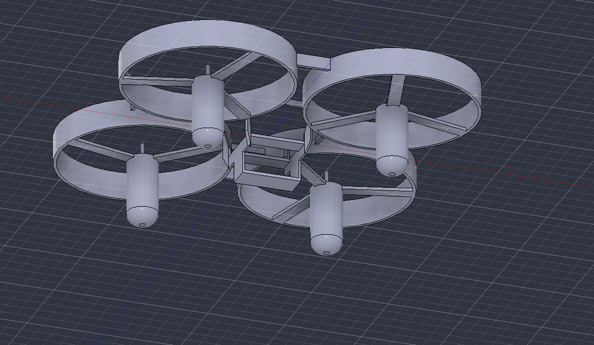
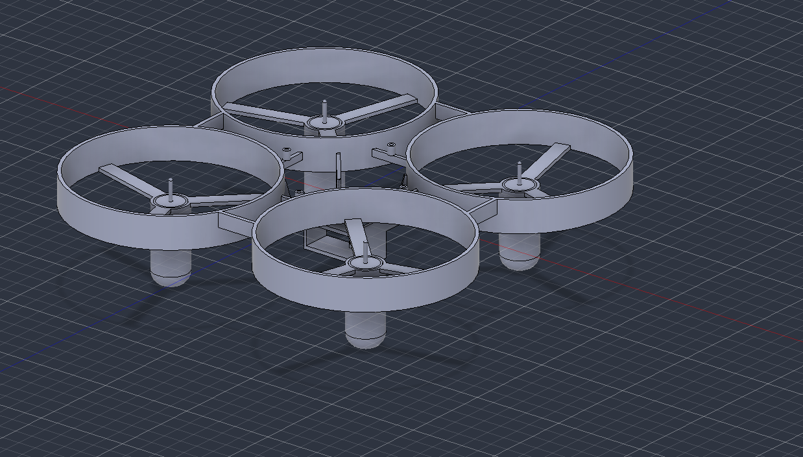
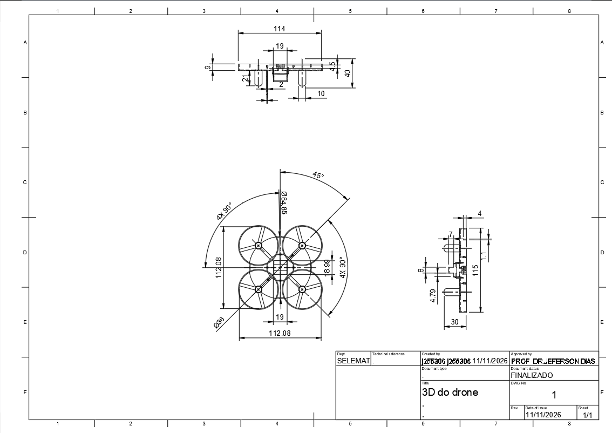
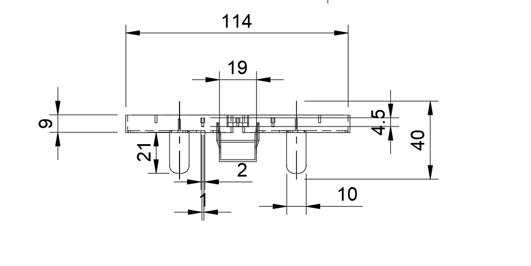
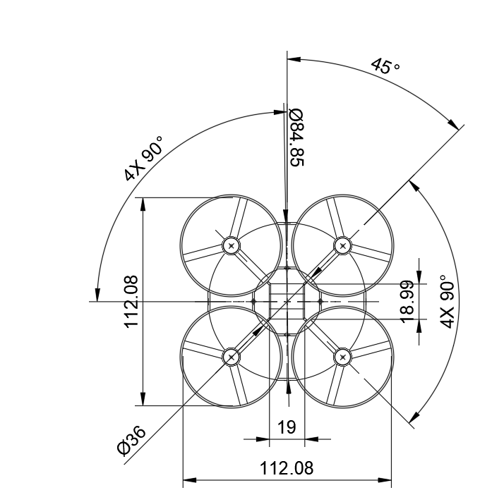
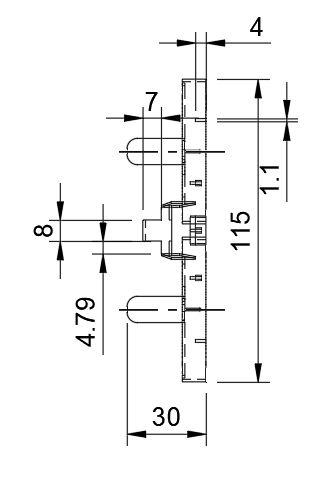
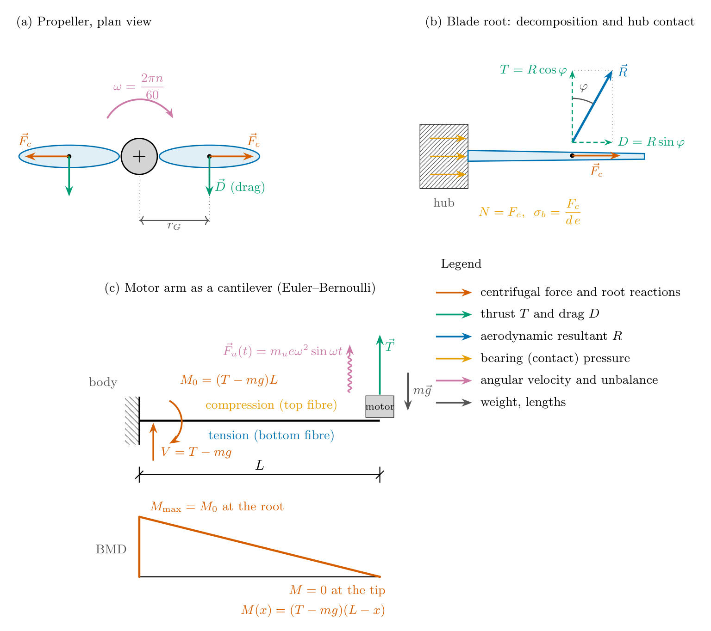

# CAD Specification - UAV Fuselage

Models, drawings and renders of the ducted-quadcopter fuselage studied in this project. Images in `figures/` were taken from the team's report draft (the team's local draft, not published). Native CAD files (`.dwg`, `.SLDPRT`, ...) go in this folder; temporary/backup CAD files are ignored by `.gitignore`.

## 1. 3D model (perspective views)

The model is a quad-duct airframe: four annular ducts (shrouds) with three-spoke motor mounts, a central body/battery cradle and four motor pods, in a 4 x 90 deg arrangement.

| | |
|---|---|
|  |  |
| **Figure 1a** - Perspective view Xa (from below) | **Figure 1b** - Perspective view Xb (from above) |

## 2. 2D technical drawing

**Figure 2** - Drawing Y: sheet "3D do drone", DWG No. 1, dept. SELEMAT, issued 11/11/2026, approver Prof. Dr. Jeferson Dias, status FINALIZADO.

The sheet places the plan view **below** the front view and the side view to its right, which is the layout of **first-angle projection** (ISO 5456-2 [3]). Put the first-angle symbol in the title block and confirm the method required by the course.

### Enlarged views

| Front (Za) | Top (Zb) | Side (Zc) |
|:-:|:-:|:-:|
|  |  |  |
| Fig. 3a | Fig. 3b | Fig. 3c |

### Dimensions read from the drawing (mm)

| View | Dimension | Value |
|---|---|---|
| Top | Overall envelope (both axes) | 112.08 |
| Top | Motor/duct pitch circle diameter | Ø84.85 |
| Top | Duct angular spacing | 4 x 90 deg (45 deg to diagonal) |
| Top | Central body width / length | 19 / 18.99 |
| Top | Feature diameter (leader on duct) | Ø36 |
| Front | Overall width / height | 114 / 40 |
| Front | Body strip height / pod length | 9 / 21 (pod Ø10) |
| Front | Body cradle width / depth | 19 / 2 |
| Side | Overall length / height | 115 / 30 |
| Side | Pod length / offsets | 7, 8, 4.79 |
| Side | Wall features | 4, 1.1 |

> Some dimension-to-feature assignments (e.g. Ø36, 1.1, 4.5) cannot be read unambiguously from the raster images. Confirm them against the native CAD file and list the wall thickness explicitly - it is the free variable of the merit indices (README, Section 2).

## 3. Load paths on the motor arm

**Figure 4** - Load paths on a blade, hub and motor arm (TikZ + stanli source: [`docs/tikz/load_paths.tex`](../docs/tikz/load_paths.tex)): centrifugal tension and local hub compression, decomposition of the aerodynamic resultant into thrust and drag, cantilever bending of the arm with its bending-moment diagram, and the rotating unbalance.

## 4. Deliverable checklist

| Item | Format | Status / filename |
|---|---|---|
| 3D model | SolidWorks / AutoCAD | `fuselage.*` (add native file) |
| Interchange | STEP AP214 | `fuselage.step` (to do) |
| Drawing with dimensions **and tolerances** (brief requirement) | DWG + PDF | Sheet exists; **add ISO 2768-m note and individual tolerances** |
| Views and perspectives | PNG | done (`figures/`) |
| Section view through body (optional) | DWG | to do |
| Wall thickness / mass properties per candidate material | table | to do |

## 5. ISO 2768 general tolerances

Add the note **"ISO 2768-m"** (or "ISO 2768-mK") in the title block [4, 5]. Values below are transcribed from the standard; verify against your copy.

**Linear dimensions (mm), class m (medium):**

| Range | 0.5-3 | >3-6 | >6-30 | >30-120 | >120-400 | >400-1000 | >1000-2000 |
|---|---|---|---|---|---|---|---|
| Tolerance | +-0.1 | +-0.1 | +-0.2 | +-0.3 | +-0.5 | +-0.8 | +-1.2 |

**Chamfer heights and external radii (mm), class m:**

| Range | 0.5-3 | >3-6 | >6 |
|---|---|---|---|
| Tolerance | +-0.2 | +-0.5 | +-1.0 |

**Angular dimensions, class m (length of shorter leg, mm):**

| Range | up to 10 | >10-50 | >50-120 | >120-400 | >400 |
|---|---|---|---|---|---|
| Tolerance | +-1 deg | +-0 deg 30' | +-0 deg 20' | +-0 deg 10' | +-0 deg 5' |

**Geometrical tolerances, ISO 2768-2 class H (if "mH" is used) [5]:**

| Nominal length (mm) | up to 10 | >10-30 | >30-100 | >100-300 | >300-1000 | >1000-3000 |
|---|---|---|---|---|---|---|
| Straightness / flatness | 0.02 | 0.05 | 0.1 | 0.2 | 0.3 | 0.4 |

### Resulting general tolerances for this part

| Feature (from drawing) | Nominal | ISO 2768-m limit |
|---|---|---|
| Overall envelope | 112.08 | +-0.3 |
| Front width / side length | 114 / 115 | +-0.3 |
| Height | 40 | +-0.3 |
| Pitch circle Ø84.85 | 84.85 | +-0.3 |
| Body width | 19 | +-0.2 |
| Pod length | 21 | +-0.2 |
| Duct spacing angle | 90 deg (diagonal arm length ~ 60 mm) | +-0 deg 20' |

Individual (tighter) tolerances proposed for critical features - to be justified in the report:

| Feature | Tolerance | Reason |
|---|---|---|
| Motor mount flatness | 0.05 | Thrust alignment, vibration |
| Motor mount hole position | +-0.1 | Bolt pattern |
| Duct inner diameter | +-0.1 | Propeller tip clearance (efficiency) |

## References

[3] ISO 5456-2:1996. *Technical drawings - Projection methods - Part 2: Orthographic representations*. Geneva: ISO, 1996.
[4] ISO 2768-1:1989. *General tolerances - Part 1: Tolerances for linear and angular dimensions without individual tolerance indications*. Geneva: ISO, 1989.
[5] ISO 2768-2:1989. *General tolerances - Part 2: Geometrical tolerances for features without individual tolerance indications*. Geneva: ISO, 1989.

(Reference numbers match the main [README](../README.md#references).)
