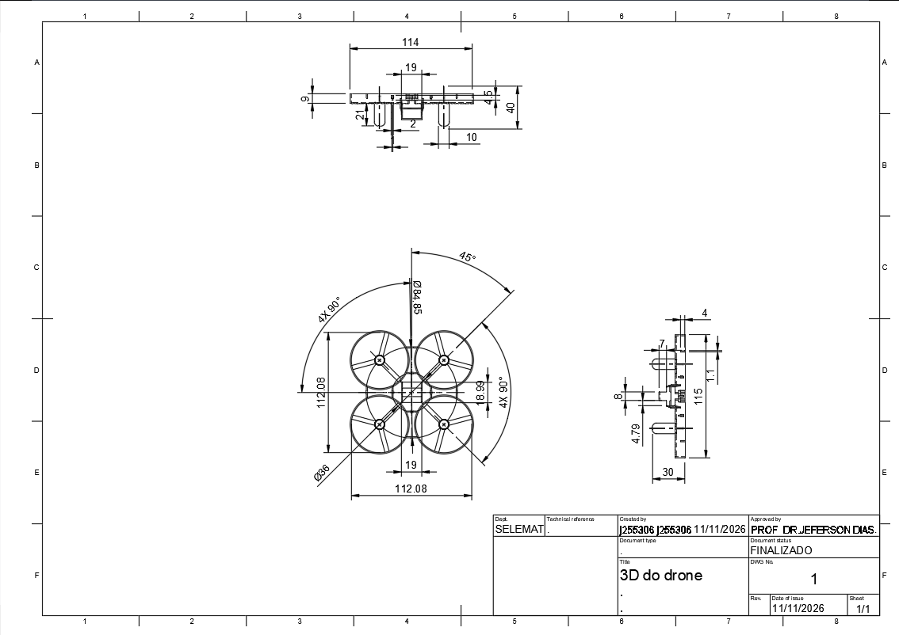
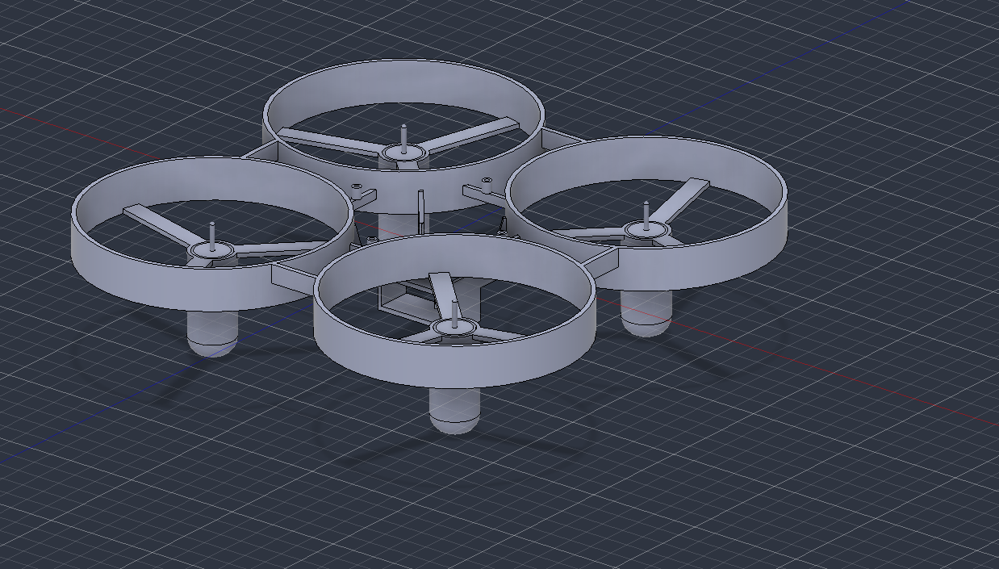
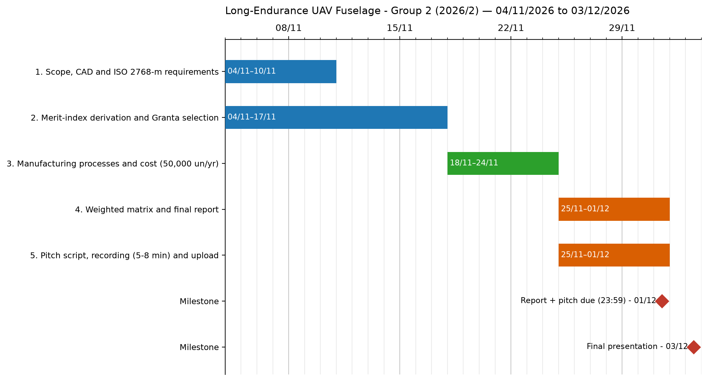

<!-- NOTAS DE AUTORIA: edite apenas o texto abaixo. Gere o .docx com:
     python docs/unicamp_deliverable/build_docx_report.py
     Os valores numéricos vêm do README.md (inglês); atualize-os após a exportação final do Ansys Granta. -->

# 1 Introdução

Este relatório apresenta a seleção de materiais e o projeto de manufatura da fuselagem de um quadricóptero de longa autonomia destinado ao mapeamento ambiental, com volume de produção de 50.000 unidades por ano e tolerâncias gerais conforme a norma ISO 2768-m. O método de Ashby foi empregado para traduzir requisitos funcionais em índices de mérito, e o *software* Ansys Granta foi utilizado para a triagem e o mapeamento visual dos candidatos.

**Objetivo geral.** Selecionar o material e o processo de fabricação que minimizem a massa e o custo da fuselagem, atendendo aos requisitos de rigidez, resistência, tenacidade e durabilidade ambiental.

**Objetivos específicos.**

- Definir requisitos funcionais, restrições e objetivos do componente.
- Deduzir os índices de mérito de flexão de painel, resistência à tração e custo volumétrico.
- Triar os materiais candidatos (CFRP, PEEK com 30% de fibra de carbono, policarbonato e liga Al 7075-T6).
- Definir o processo de manufatura e o isolamento de vibração dos motores.
- Recomendar o material final por meio de uma matriz de decisão ponderada.

# 2 Especificações do Produto

## 2.1 Requisitos funcionais

<!-- Preencher: massa máxima de decolagem, autonomia-alvo, carga útil, ambiente de operação. -->

| Parâmetro | Valor | Observação |
|---|---|---|
| Autonomia-alvo | ≥ 45 min | Premissa de projeto |
| Envelope em planta | 112,08 × 112,08 mm | Desenho técnico (CAD) |
| Altura / comprimento | 40 mm / 115 mm | Desenho técnico (CAD) |
| Massa máxima de decolagem | 150 g | Premissa de projeto |
| Massa-alvo da fuselagem | ≤ 22 g | Premissa de projeto |
| Volume de produção | 50.000 un./ano | Dado do enunciado |
| Tolerâncias gerais | ISO 2768-m | Dado do enunciado |

## 2.2 Geometria do componente

O modelo é um quadricóptero com quatro dutos (envelope de 112 × 112 × 40 mm), corpo central e quatro nacelas de motor. Descrever a espessura de parede e os pontos de fixação (motores, bateria, carga útil).

# 3 Índices de Mérito

## 3.1 Painel leve e rígido em flexão

Para um painel de comprimento *L* e largura *w* fixos e espessura *t* livre, a rigidez à flexão é S = C·E·w·t³/L³. Isolando *t* e substituindo na massa m = ρ·L·w·t, obtém-se que a massa é minimizada maximizando o índice **IM1 = E^(1/3)/ρ**.

## 3.2 Resistência à tração com massa mínima

Para um elemento tracionado por uma força F, a área necessária é A = F/σ_y e a massa m = ρ·A·L. Portanto, o índice é **IM2 = σ_y/ρ**.

## 3.3 Custo volumétrico

Com o custo volumétrico C_v,R = C_m·ρ (R$/m³ ou US$/m³), o custo do painel de rigidez prescrita varia com C_v,R/E^(1/3), de modo que o índice a maximizar é **IM3 = E^(1/3)/C_v,R**.

## 3.4 Hipóteses e limitações

As deduções assumem regime elástico linear (lei de Hooke), teoria de pequenas deflexões e material isotrópico ou quase-isotrópico. Os índices não consideram anisotropia de laminados, concentração de tensões, flambagem local, fadiga nem efeitos higrotérmicos.

# 4 Triagem no Ansys Granta e Mapas de Ashby

Descrever o estágio de limite, os gráficos de Ashby utilizados (E–ρ com linha-guia de inclinação 3; σ_y–ρ com inclinação 1) e os materiais sobreviventes. Anexar capturas de tela (ver `docs/ansys_granta_notes.md`).

| Material | ρ (kg/m³) | E (GPa) | σ_y (MPa) | K_Ic (MPa·m^0,5) | IM1 | IM2 | IM3 |
|---|---|---|---|---|---|---|---|
| CFRP quase-isotrópico | 1550 | 48 | 600 | 30 | 2,34 | 387 | 0,04 |
| PEEK 30% CF | 1410 | 13 | 200 | 6 | 1,67 | 142 | 0,02 |
| Policarbonato | 1200 | 2,3 | 62 | 2,1 | 1,10 | 52 | 0,31 |
| Al 7075-T6 | 2810 | 71,7 | 503 | 29 | 1,48 | 179 | 0,33 |

# 5 Filtros Ambientais Avançados

Aplicaram-se as restrições: resistência a UV mínima "Aceitável", absorção de água em 24 h inferior a 0,2% e tenacidade à fratura K_Ic superior a 2,0 MPa·m^0,5. Discutir o desempenho de cada candidato (por exemplo, a necessidade de verniz com proteção UV no CFRP e o uso de grau estabilizado no policarbonato).

# 6 Engenharia do Processo de Manufatura

## 6.1 Usinagem CNC multieixos de alta velocidade

Descrever a usinagem a 20.000 rpm, estratégias de trajetória, fixação, ferramentas e a inspeção dimensional conforme ISO 2768-m (inspirada em práticas de fuselagens monobloco de drones comerciais).

## 6.2 Cura em autoclave do CFRP

Descrever o ciclo de cura (patamar de temperatura, pressão e vácuo), a taxa de aquecimento e resfriamento e a viabilidade para 50.000 unidades/ano.

## 6.3 Isolamento de vibração dos motores

Os motores *brushless* a 40.000 rpm excitam a estrutura em 666,7 Hz. Com amortecedores elastoméricos de frequência natural de até 182 Hz e razão de amortecimento de 0,1, a transmissibilidade é de aproximadamente 0,1 (isolamento de 90%).

# 7 Matriz de Decisão e Recomendação Final

| Material | Desempenho mecânico (0,35) | Custo (0,25) | Manufaturabilidade (0,20) | Durabilidade (0,20) | Total |
|---|---|---|---|---|---|
| Al 7075-T6 | 0,546 | 1,000 | 0,800 | 0,600 | 0,721 |
| Policarbonato | 0,301 | 0,957 | 1,000 | 0,600 | 0,665 |
| CFRP quase-isotrópico | 1,000 | 0,119 | 0,400 | 0,800 | 0,620 |
| PEEK 30% CF | 0,539 | 0,056 | 0,800 | 1,000 | 0,563 |

Discutir a recomendação final, a análise de sensibilidade aos pesos e as ressalvas.

# 8 Gestão do Projeto

Apresentar a divisão de tarefas entre os seis membros e o cronograma (4 de novembro a 3 de dezembro de 2026; entrega do relatório e do pitch em 01/12/2026 às 23h59; apresentação em 03/12/2026).

# 9 Conclusões

Sintetizar os resultados, as limitações do modelo e os próximos passos.

# Referências

[1] ASHBY, M. F. **Materials Selection in Mechanical Design**. 5. ed. Oxford: Butterworth-Heinemann, 2016.

[2] ASHBY, M. F.; SHERCLIFF, H.; CEBON, D. **Materials**: Engineering, Science, Processing and Design. 4. ed. Oxford: Butterworth-Heinemann, 2019.

[3] CALLISTER JR., W. D.; RETHWISCH, D. G. **Ciência e Engenharia de Materiais**: uma introdução. 10. ed. Rio de Janeiro: LTC, 2020.

[4] FERRANTE, M. **Seleção de Materiais**. 2. ed. São Carlos: EdUFSCar, 2002.

[5] INTERNATIONAL ORGANIZATION FOR STANDARDIZATION. **ISO 2768-1**: General tolerances – Part 1: Tolerances for linear and angular dimensions without individual tolerance indications. Geneva: ISO, 1989.

[6] INTERNATIONAL ORGANIZATION FOR STANDARDIZATION. **ISO 2768-2**: General tolerances – Part 2: Geometrical tolerances for features without individual tolerance indications. Geneva: ISO, 1989.

[7] DIAS, J. A. **Aulas 1 a 6 da disciplina ER700/EU910**. Limeira: FCA/UNICAMP, 2026.

[8] DIAS, J. A. **Projeto de seleção de materiais – 2026/2**. Limeira: FCA/UNICAMP, 2026.

[9] ANSYS, INC. **Ansys Granta EduPack**. Canonsburg: Ansys, [s.d.].

[10] MATWEB LLC. **MatWeb**: Material Property Data. Disponível em: https://www.matweb.com. Acesso em: [data].
